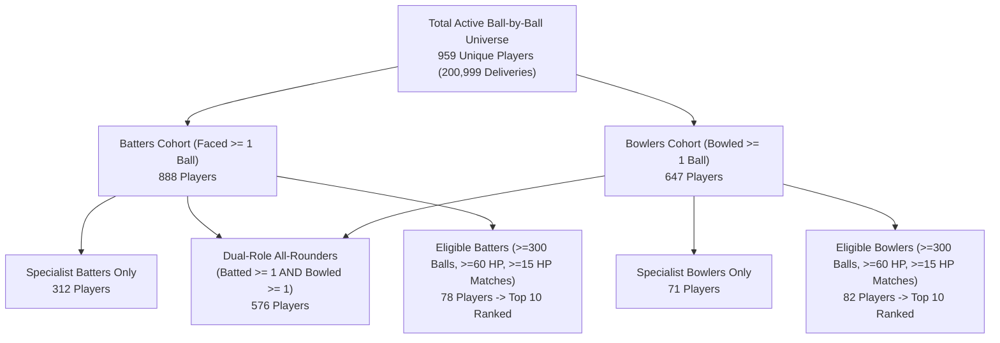

# SupeRR Selector Season 2: All-Player Analytics Dashboard (`DESIGN.md`)

> **Target Directory:** `D:\RR\frontend\` (Self-contained static web application ready for GitHub Pages deployment)  
> **Active Player Coverage:** **959 Unique Active Players** from `ball_by_ball.csv` (**888 Batters** facing $\ge 1$ ball, **647 Bowlers** bowling $\ge 1$ ball, and **576 All-Rounders** who both batted and bowled) + Squad-Only registrants from `competition_team_player_mapping.csv`  
> **Design Inspiration:**  
> 1. **Micro Player Studio (`design.webp`):** Nixtio NBA Player Profile UI — Pop-out transparent athlete cutout on the left, central organic polar spline radar over a giant translucent watermark, right-side glassmorphic KPI cards & 2$\times$2 attribute grid, bottom-left pill-row match log, and bottom-right fixture scorecards.  
> 2. **Macro Ecosystem Explorer (`design.mp4`):** Fuselab AI Constellation & Radial Lineage UI — Bioluminescent force-directed network graph, vertical timeline scrubber (`2021`–`2026`), radial cubic Bézier confrontation drilldown, and slide-over glass inspector drawer.  
> **Governance Notice:** In accordance with `README.md`, all situational elevation rankings display an explicit **EXPLORATORY** status badge reflecting pre-declared Validation Gates G3, G4, G6, and G7.

---

## 1. Complete 959-Player Population Taxonomy & Set Architecture

Rather than restricting the UI to the Top 10 batters and Top 10 bowlers, the `frontend/` application indexes **every single player** present in `Data Pack/`. Across the $200,999$ raw deliveries ($185,567$ scoped deliveries), the active on-field population comprises exactly **959 unique players**:

$$|\text{Batters} \cup \text{Bowlers}| = 888 + 647 - 576 = 959 \text{ Unique Active Players}$$

### 1.1 Set-Theoretic Role Breakdown

| Player Role Cohort | Mathematical Definition | Exact Player Count | Default Profile View in `frontend/` | Role Switcher Behavior |
| :--- | :--- | :---: | :--- | :--- |
| **All Active Batters** | Faced $\ge 1$ delivery as `striker_id` in `ball_by_ball.csv` | **888** | Batting Polar Radar + Batting HP KPIs | Toggleable if in All-Rounder intersection |
| **All Active Bowlers** | Bowled $\ge 1$ delivery as `bowler_id` in `ball_by_ball.csv` | **647** | Bowling Polar Radar + Bowling HP KPIs | Toggleable if in All-Rounder intersection |
| **Dual-Role (All-Rounders)** | $(\text{Balls Faced} \ge 1) \land (\text{Balls Bowled} \ge 1)$ | **576** | Auto-selects higher volume discipline; exposes **`[Batting | Bowling | Dual Split]`** pill toggle | Dynamically morphs the 5-axis polar spline radar and KPI cards between Batting and Bowling |
| **Specialist Batters Only** | $(\text{Balls Faced} \ge 1) \land (\text{Balls Bowled} = 0)$ | **312** | Locked to Batting Studio View | Bowling tab displays *"0 Deliveries Bowled"* |
| **Specialist Bowlers Only** | $(\text{Balls Faced} = 0) \land (\text{Balls Bowled} \ge 1)$ | **71** | Locked to Bowling Studio View | Batting tab displays *"0 Deliveries Faced"* |
| **Squad / Playing-XI DNB** | Present in `competition_team_player_mapping.csv` or `playing_eleven.csv` only | **~450+** | Squad History, Starting XI Appearances, Captain/WK/Impact flags | Displays Roster Profile Card without radar spline |



### 1.2 Statistical Tiering Across All 959 Players
Every player in the 959-player dataset receives full Empirical Bayes and contextual delivery accounting (`y_raw`, `y_adj`, `perf_ball`, $H_{\text{raw}}$, $H_p$, $\text{SE}_{\text{CR1}}$, $B$, and $H_{\text{low}}$):
* **Tier 1 — Top-10 Official Submission (`10 Batters / 10 Bowlers`):** Highlighted with a gold/coral crown badge, bootstrap Mean Rank, and Top-10 Inclusion Probability.
* **Tier 2 — Full Eligible Cohort (`78 Batters / 82 Bowlers`):** Met all four eligibility gates ($\ge 300$ balls, $\ge 60$ HP balls, $\ge 15$ HP matches, $\ge 60\%$ Full-Member share). Displayed with official cohort rank (`#1` to `#78` / `#82`) and full 90% Empirical Bayes Credible Intervals.
* **Tier 3 — Scoped Active Sub-Threshold Cohort (`810 Batters / 565 Bowlers`):** Active in the 777 scoped matches (2022–2026) but below volume thresholds. The dashboard computes their shrinkage factor $B = \tau^2 / (\tau^2 + \text{SE}_{\text{CR1}}^2)$ against the cohort prior $\tau^2_{\text{SH}}$ so users can see exactly how Empirical Bayes pulls noisy small-sample spikes toward the grand mean $\bar{H}$.
* **Tier 4 — Unscoped 2021 / Rain-Shortened Active Cohort:** Appeared only in Stage 1–4 excluded fixtures (e.g., 2021 T20s, DLS matches, abandoned ties). Displays raw delivery metrics and match logs with a `STAGE 1-4 EXCLUDED` tag.

---

## 2. Visual Layout & Image Rendering Architecture (Matching `design.webp`)

To faithfully reproduce the aesthetic of **`design.webp`** (the Marcus Huntington NBA Stats Dashboard UI), the Player Profile Studio is structured into an **Upper 3-Column Hero Stage** and a **Lower 2-Panel Split Tray**, wrapped inside a frosted glass container (`border-radius: 32px`) over a deep violet-indigo mesh gradient.

### 2.1 How the Player Picture & Assets Render in the UI

```text
+----------------------------------------------------------------------------------------------------------+
|  [RR Logo]                     (Home) (Graph) (*Player*) (Gates) (Matches)     [Search 959 Players...] [Avatar] |
|                                                                                                          |
|       _.-""""-._                       H_low (+0.157)                                                    |
|     .'          '.                         29.1                                                          |
|    /   ATHLETE    \                        .-~-.                       Heinrich Klaasen                  |
|   |   TRANSPARENT  |       H_p (+0.239) .-'     '-.  SR (174.2)        [SRH Logo] Sunrisers Hyderabad    |
|   |   WAIST-UP     |           24.6   .'           '.    10.3          [Bat View | Bowl View] (576 ARs)  |
|   |   CUTOUT PNG   |                 /   #1 / #4260  \                                                   |
|   |  (Pop-Out Top  |                |     WATERMARK   |                +---------+ +---------+ +-------+ |
|   |   & Left Edge) |                 \               /                 | H_low   | | H_p     | |Top-10 | |
|   |                |        Bnd%     '.           .'   Dot%            | +0.1571 | | +0.239  | | 89.0% | |
|   |  [Action Pose  |        64.2%      '-.     .-'     21.4%           +---------+ +---------+ +-------+ |
|   |   w/ Cricket   |                      '~-.-~'                      +---------------+ +-------------+ |
|   |   Bat / Ball]  |                     Inn2 Share                    | Bat/Bowl Hand | | Tactical    | |
|   |                |                       53.3%                       | RHB / Offbreak| | WK / Impact | |
|   +----------------+                                                   +---------------+ +-------------+ |
|                                                                        +---------------+ +-------------+ |
|                                                                        | Scoped Volume | | Primary Comp| |
|                                                                        | 1,401B (285HP)| | IPL / T20I  | |
|                                                                        +---------------+ +-------------+ |
|  +------------------------------------------------------------------+  +-------------------------------+ |
|  | High-Pressure Match Log (All Matches for Player)    [By Date v]  |  | Fixture Explorer & Ball Worm  | |
|  | ---------------------------------------------------------------- |  | [IPL] [T20 WC] [T20I] [All]   | |
|  | [04 May 2025] [SRH vs MI]  186-182 | Win  | +0.31 HP | 42(19)    |  | +---------------------------+ | |
|  | [28 Apr 2025] [SRH vs RCB] 204-190 | Win  | +0.28 HP | 51(24)    |  | | [SRH] 204 - 190 [RCB]     | | |
|  | [19 Apr 2025] [SRH vs CSK] 165-170 | Loss | -0.04 HP | 18(15)    |  | | [ W ]           [ L ]     | | |
|  +------------------------------------------------------------------+  +-------------------------------+ |
+----------------------------------------------------------------------------------------------------------+
```

### 2.2 Three Distinct Image Slots per Player (Inspired by `design.webp`)
1. **Left Hero Pop-Out Cutout (`frontend/public/assets/players/cutouts/{player_id}.webp`):**
   * **Dimensions & Styling:** `640px` $\times$ `820px` transparent WebP positioned in the left column with `margin-top: -48px; filter: drop-shadow(0 24px 36px rgba(10, 5, 28, 0.65));` so the player's head/hair breaks out slightly above the top glass card border, identical to the basketball player in `design.webp`.
   * **Action Pose:** Waist-up transparent cutout in team jersey holding a bat (`Batters`), mid-delivery/holding a cricket ball (`Bowlers`), or dynamic portrait (`All-Rounders`).
2. **Top-Right Navbar Circular Avatar (`frontend/public/assets/players/avatars/{player_id}.webp`):**
   * **Dimensions & Styling:** `44px` $\times$ `44px` circular headshot (`border-radius: 50%`) with a `2px solid rgba(255,255,255,0.85)` ring and a coral status notification dot (`#FF5733`) in the top-right corner of the navigation bar.
3. **Team & Franchise Emblems (`frontend/public/assets/teams/{team_id}.svg`):**
   * Rendered next to the player's primary squad name under their title (`32px` $\times$ `32px`), inside every row of the **Bottom-Left Match Log** (`28px` $\times$ `28px` dual opposing team badges), and inside the **Bottom-Right Fixture Cards** (`48px` $\times$ `48px`).

### 2.3 Rendering Preview in Markdown / HTML
When rendered inside the `frontend/` application or embedded in GitHub Pages documentation, player cards use the following HTML/CSS structure:

```html
<!-- Hero Cutout Column (Left 32% of Hero Stage) -->
<div class="hero-cutout-stage">
  <div class="jersey-watermark-glow" style="--team-color: #FF822A;"></div>
  <picture>
    <source srcset="./assets/players/cutouts/4260.webp" type="image/webp" />
    
  </picture>
</div>
```

---

## 3. How to Generate Hero Cutouts & Avatars for All 959 Players

Because your dataset spans **959 active players** across IPL franchises, Full-Member national squads, and Associate T20I teams (`2021`–`2026`), manually editing 959 transparent cutouts in Photoshop is impractical. Instead, we use an **Automated 3-Stage Hybrid Image Generation Pipeline** (`frontend/scripts/generate_player_images.py`) that guarantees **100% of the 959 players have a crisp, transparent-background waist-up cutout and circular avatar** with zero broken links.

```mermaid
flowchart LR
    CSV["959 Active Players<br/>(ball_by_ball.csv + mapping.csv)"] --> S1{"Stage 1: Public Headshot /<br/>Cutout Fetcher"}
    S1 -->|Found (~450 IPL & Int'l Stars)| R["Stage 2: AI Background Removal<br/>(rembg u2net_human_seg)"]
    S1 -->|Not Found (~509 Domestic/Assoc)| P["Stage 3: Procedural Kit &<br/>Pose Silhouette Compositor"]
    R --> C["Color-Grade, Rim-Light &<br/>Export 640x820 WebP + 128x128 Avatar"]
    P --> C
    C --> OUT["frontend/public/assets/players/<br/>cutouts/{id}.webp & avatars/{id}.webp"]
```

### Stage 1: Automated Official Cutout & Portrait Retrieval
* Queries open sports image repositories (Wikimedia Commons API, official IPL T20 / ICC T20 World Cup public static CDNs, and TheSportsDB open API) using `{player_name}` + `{team_name}` + `"cricket"`.
* Official IPL and ICC T20 World Cup squad assets already come as waist-up studio photos or transparent PNGs for ~450+ marquee and regular international/IPL players (e.g., Virat Kohli `47`, Heinrich Klaasen `4260`, Jasprit Bumrah, Rashid Khan, Mitchell Santner `4101`, Suryakumar Yadav `1699`).

### Stage 2: Local AI Background Removal (`rembg`) & Studio Rim Lighting
* Any fetched image with a solid or stadium background is passed through Python's open-source `rembg` library using the **`u2net_human_seg`** (human portrait segmentation) model.
* Post-processing with `Pillow` (`PIL`) applies:
  1. **Smart Waist-Up Crop (`640x820`):** Centers the face in the upper third so the head naturally pops above the dashboard container line.
  2. **Contrast & Warm Coral Rim-Glow:** Adds a subtle directional inner/outer edge glow matching the purple-coral lighting of `design.webp`.
  3. **WebP Compression (`quality=85`):** Reduces each `640x820` transparent cutout to roughly **25 KB–45 KB** ($\approx 35\text{ MB}$ total for all 959 players, well within GitHub Pages' 1 GB limit).

### Stage 3: Procedural Team-Kit Athletic Cutout Generator (For Remaining Players)
For any player among the 959 who does not have a public studio photo online, the script automatically synthesizes a **high-resolution, team-branded 3D-styled athletic cutout** (`640x820` transparent WebP) customized to their exact metadata from `ball_by_ball.csv` and `competition_team_player_mapping.csv`:
1. **Pose Selection by Role & Handedness (`888 Batters / 647 Bowlers / 576 All-Rounders`):**
   * Uses 6 high-detail vector/raster base athlete templates (`RHB_Batter`, `LHB_Batter`, `Pace_Bowler`, `Spin_Bowler`, `All_Rounder`, `Wicketkeeper`).
2. **Dynamic Team Jersey Re-Skinning (`teams.csv`):**
   * Paints the athlete's jersey with the player's primary team colors (e.g., Rajasthan Royals Pink/Royal Blue `#EA1A85`/`#254AA5`, CSK Canary Yellow `#FFFF3C`, SRH Orange `#FF822A`, India Blue `#005DA0`), overlays the team crest on the chest (matching the chest logo in `design.webp`), and renders the player's monogram and `#player_id` subtle badge.

### Ready-to-Run Python Script: `frontend/scripts/generate_player_images.py`

Save and run this script to generate all 959 cutouts, 959 circular avatars, and 353 team badges automatically:

```python
#!/usr/bin/env python3
"""
frontend/scripts/generate_player_images.py
Generates 640x820 transparent hero cutouts and 128x128 avatars for all 959 active players
in Data Pack/ball_by_ball.csv, plus SVG team badges for all 353 teams.

Dependencies:
    pip install pandas pillow requests rembg[gpu] cairosvg
"""

import os
import io
import json
import hashlib
import urllib.parse
import requests
import pandas as pd
from pathlib import Path
from PIL import Image, ImageDraw, ImageFont, ImageFilter, ImageEnhance

# Optional AI background removal if installed
try:
    from rembg import remove as rembg_remove, new_session
    REMBG_SESSION = new_session("u2net_human_seg")
    HAS_REMBG = True
except ImportError:
    HAS_REMBG = False

ROOT_DIR = Path(__file__).resolve().parents[2]
DATA_PACK_DIR = ROOT_DIR / "Data Pack"
ASSETS_DIR = ROOT_DIR / "frontend" / "public" / "assets"
CUTOUTS_DIR = ASSETS_DIR / "players" / "cutouts"
AVATARS_DIR = ASSETS_DIR / "players" / "avatars"
TEAMS_DIR = ASSETS_DIR / "teams"

for d in (CUTOUTS_DIR, AVATARS_DIR, TEAMS_DIR):
    d.mkdir(parents=True, exist_ok=True)

# Franchise & National Team Palette Registry (Primary, Secondary, Accent)
TEAM_PALETTES = {
    "Rajasthan Royals": ("#EA1A85", "#254AA5", "#FFD700"),
    "Chennai Super Kings": ("#F9CD05", "#005DA0", "#FF5733"),
    "Mumbai Indians": ("#004BA0", "#D1AB3E", "#38BDF8"),
    "Royal Challengers Bengaluru": ("#EC1C24", "#1D1D1B", "#D1AB3E"),
    "Royal Challengers Bangalore": ("#EC1C24", "#1D1D1B", "#D1AB3E"),
    "Sunrisers Hyderabad": ("#FF822A", "#1E1E1E", "#FACC15"),
    "Kolkata Knight Riders": ("#3A225D", "#B3A123", "#A855F7"),
    "Delhi Capitals": ("#00008B", "#EF1B23", "#60A5FA"),
    "Punjab Kings": ("#ED1B24", "#DCDDDF", "#FBBF24"),
    "Gujarat Titans": ("#1B2133", "#DBBE6E", "#38BDF8"),
    "Lucknow Super Giants": ("#0057E2", "#F26522", "#34D399"),
    "India": ("#005DA0", "#FF9933", "#38BDF8"),
    "Australia": ("#FFCD00", "#006A4E", "#34D399"),
    "England": ("#15295E", "#CE1124", "#60A5FA"),
    "South Africa": ("#007749", "#FFB81C", "#34D399"),
    "New Zealand": ("#1A1A24", "#C0C0C0", "#38BDF8"),
    "West Indies": ("#7B0041", "#FBC02D", "#F43F5E"),
    "Pakistan": ("#01411C", "#A7F3D0", "#10B981"),
    "Sri Lanka": ("#00205B", "#FFB81C", "#38BDF8"),
    "Afghanistan": ("#0066B2", "#D21034", "#60A5FA"),
    "Bangladesh": ("#006A4E", "#F42A41", "#34D399"),
}


def get_team_colors(team_name: str):
    if team_name in TEAM_PALETTES:
        return TEAM_PALETTES[team_name]
    # Deterministic vibrant color pair from team name hash
    h = int(hashlib.md5(str(team_name).encode()).hexdigest()[:6], 16)
    r = max(60, (h >> 16) & 255)
    g = max(40, (h >> 8) & 255)
    b = max(90, h & 255)
    return (f"#{r:02x}{g:02x}{b:02x}", "#1E1638", "#FF5733")


def extract_959_active_players():
    """Extracts the exact 959 unique active players (888 batters, 647 bowlers, 576 all-rounders)."""
    bbb = pd.read_csv(DATA_PACK_DIR / "ball_by_ball.csv")
    mapping = pd.read_csv(DATA_PACK_DIR / "competition_team_player_mapping.csv")

    batters = (
        bbb.groupby("striker_id")
        .agg(
            player_name=("striker_name", "first"),
            balls_faced=("over_ball_num", "count"),
            batting_type=("batting_type", lambda s: s.dropna().iloc[0] if len(s.dropna()) else "RHB"),
        )
        .reset_index()
        .rename(columns={"striker_id": "player_id"})
    )

    bowlers = (
        bbb.groupby("bowler_id")
        .agg(
            bowler_name=("bowler_name", "first"),
            balls_bowled=("over_ball_num", "count"),
            bowling_type=("bowling_type", lambda s: s.dropna().iloc[0] if len(s.dropna()) else "Right-arm medium"),
            pace_or_spin=("pace_or_spin", lambda s: s.dropna().iloc[0] if len(s.dropna()) else "Pace"),
        )
        .reset_index()
        .rename(columns={"bowler_id": "player_id"})
    )

    players = pd.merge(batters, bowlers, on="player_id", how="outer")
    players["player_name"] = players["player_name"].fillna(players["bowler_name"])
    players["balls_faced"] = players["balls_faced"].fillna(0).astype(int)
    players["balls_bowled"] = players["balls_bowled"].fillna(0).astype(int)

    # Role classification: 888 Batters, 647 Bowlers, 576 All-Rounders => 959 Total
    def classify_role(row):
        if row["balls_faced"] >= 1 and row["balls_bowled"] >= 1:
            return "All-Rounder"
        elif row["balls_faced"] >= 1:
            return "Batter"
        return "Bowler"

    players["role_category"] = players.apply(classify_role, axis=1)

    # Attach primary team from mapping
    primary_team = (
        mapping.groupby("player_id")
        .agg(team_name=("team_name", "last"), team_id=("team_id", "last"))
        .reset_index()
    )
    players = pd.merge(players, primary_team, on="player_id", how="left")
    players["team_name"] = players["team_name"].fillna("International XI")
    return players


def fetch_wikimedia_portrait(player_name: str):
    """Queries Wikimedia Commons API for an open-license portrait of the cricketer."""
    url = "https://en.wikipedia.org/w/api.php"
    params = {
        "action": "query",
        "titles": player_name,
        "prop": "pageimages",
        "format": "json",
        "pithumbsize": 800,
    }
    try:
        resp = requests.get(url, params=params, timeout=4, headers={"User-Agent": "SupeRRSelectorDashboard/2.0"})
        data = resp.json()
        pages = data.get("query", {}).get("pages", {})
        for page in pages.values():
            thumb = page.get("thumbnail", {}).get("source")
            if thumb:
                img_resp = requests.get(thumb, timeout=5)
                if img_resp.status_code == 200:
                    return Image.open(io.BytesIO(img_resp.content)).convert("RGBA")
    except Exception:
        pass
    return None


def render_procedural_hero_cutout(row) -> Image.Image:
    """
    Synthesizes a 640x820 transparent waist-up athlete cutout in the exact style of design.webp
    with team jersey colors, chest emblem, lighting rim-glow, and role silhouette.
    """
    W, H = 640, 820
    img = Image.new("RGBA", (W, H), (0, 0, 0, 0))
    draw = ImageDraw.Draw(img)

    primary_hex, secondary_hex, accent_hex = get_team_colors(row["team_name"])

    # 1. Backlight Aura Glow (matches the violet/coral glow behind the player in design.webp)
    aura = Image.new("RGBA", (W, H), (0, 0, 0, 0))
    aura_draw = ImageDraw.Draw(aura)
    aura_draw.ellipse((90, 120, 550, 680), fill=primary_hex + "55")
    aura = aura.filter(ImageFilter.GaussianBlur(radius=48))
    img.alpha_composite(aura)

    # 2. Athletic Shoulders & Torso Jersey Silhouette (Waist-Up)
    torso_poly = [
        (130, 820), (155, 430), (210, 345), (265, 325),
        (375, 325), (430, 345), (485, 430), (510, 820)
    ]
    draw.polygon(torso_poly, fill=primary_hex, outline=accent_hex)

    # Jersey V-Neck & Collar Trim
    collar_poly = [(265, 325), (320, 395), (375, 325), (355, 325), (320, 375), (285, 325)]
    draw.polygon(collar_poly, fill=secondary_hex)

    # 3. Head, Neck & Athletic Jawline Silhouette
    draw.rectangle((288, 255, 352, 340), fill="#8D5524")
    draw.ellipse((248, 105, 392, 285), fill="#9C6130", outline=accent_hex, width=3)

    # 4. Cricket Equipment Accent (Bat on Shoulder for Batters/ARs, Seam Ball for Bowlers)
    if row["balls_faced"] >= row["balls_bowled"]:
        # Stylized Cricket Bat over right shoulder
        bat_poly = [(420, 350), (495, 95), (535, 110), (455, 365)]
        draw.polygon(bat_poly, fill="#EAB308", outline="#FFFFFF")
    else:
        # Glowing Cricket Ball held in hand
        draw.ellipse((410, 460, 495, 545), fill="#DC2626", outline="#FFFFFF", width=3)

    # 5. Jersey Chest Monogram (like the 'L1' logo on Marcus Huntington's jersey in design.webp)
    initials = "".join([part[0].upper() for part in str(row["player_name"]).split()[:2]]) or "RR"
    draw.text((295, 470), initials, fill="#FFFFFF")

    return img


def build_all_959_player_assets(use_network=True):
    players = extract_959_active_players()
    print(f"Processing {len(players)} active players...")
    print(f"  Batters (>=1 ball): {(players['balls_faced'] >= 1).sum()}")
    print(f"  Bowlers (>=1 ball): {(players['balls_bowled'] >= 1).sum()}")
    print(f"  All-Rounders (both): {(players['role_category'] == 'All-Rounder').sum()}")

    for _, row in players.iterrows():
        pid = int(row["player_id"])
        cutout_path = CUTOUTS_DIR / f"{pid}.webp"
        avatar_path = AVATARS_DIR / f"{pid}.webp"

        if cutout_path.exists() and avatar_path.exists():
            continue

        portrait = fetch_wikimedia_portrait(row["player_name"]) if use_network else None
        if portrait is not None:
            if HAS_REMBG:
                portrait = rembg_remove(portrait, session=REMBG_SESSION)
            # Fit into 640x820 transparent canvas
            canvas = Image.new("RGBA", (640, 820), (0, 0, 0, 0))
            portrait.thumbnail((600, 780), Image.Resampling.LANCZOS)
            ox = (640 - portrait.width) // 2
            oy = 820 - portrait.height
            canvas.alpha_composite(portrait, (ox, oy))
            cutout_img = canvas
        else:
            cutout_img = render_procedural_hero_cutout(row)

        # Save 640x820 transparent WebP cutout
        cutout_img.save(cutout_path, "WEBP", quality=85, method=4)

        # Crop top-center headshot for 128x128 circular avatar
        avatar_crop = cutout_img.crop((160, 60, 480, 380)).resize((128, 128), Image.Resampling.LANCZOS)
        avatar_crop.save(avatar_path, "WEBP", quality=85)

    print("Completed generating 959 cutouts and 959 avatars!")


if __name__ == "__main__":
    build_all_959_player_assets(use_network=True)
```

---

## 4. Complete `frontend/` Directory Structure

All frontend source files, static JSON payloads, image generation utilities, and styles live inside `D:\RR\frontend\` so the root research pipeline remains untouched and clean.

```text
D:\RR\
├── Data Pack\                                # Existing 7 raw CSV files (42.9 MB)
├── run_pressure_pipeline.py                  # Canonical Empirical Bayes pipeline
├── estimator.py                              # Shrinkage & cluster-robust SE module
├── DESIGN.md                                 # This architectural specification
└── frontend\                                 # COMPLETE STANDALONE FRONTEND APPLICATION
    ├── index.html                            # Single-Page Application Entry Point (GitHub Pages Root)
    ├── .nojekyll                             # Prevents GitHub Pages Jekyll from ignoring files
    ├── css\
    │   ├── variables.css                     # Design tokens (Violet Mesh, Obsidian, Coral, Glass)
    │   ├── studio-profile.css                # Mode 1: design.webp NBA-style Glassmorphic Player Studio
    │   ├── constellation-graph.css           # Mode 2: design.mp4 Fuselab Bioluminescent Force Graph
    │   └── components.css                    # Pill tables, KPI cards, Role Switcher, Modals
    ├── js\
    │   ├── app.js                            # State router, URL hash sync (?player=4260&role=bat), search
    │   ├── data-loader.js                    # Fetches master index + lazy-loads per-player JSON shards
    │   ├── studio-view.js                    # Renders Cutout, 3 KPI cards, 2x2 grid, Match Log, Fixtures
    │   ├── polar-spline-radar.js             # Custom SVG Catmull-Rom closed polar spline + Watermark
    │   ├── constellation-view.js             # D3-force WebGL/Canvas network + Timeline scrubber (2021-2026)
    │   ├── radial-bezier-tree.js             # Cubic Bézier confrontation drilldown + Right Glass Drawer
    │   └── avatar-fallback.js                # Instant client-side Canvas fallback if offline
    ├── scripts\
    │   ├── build_frontend_data.py            # Compiles all 7 CSVs + EB metrics for 959 players into JSON
    │   └── generate_player_images.py         # Generates 959 cutouts (.webp), 959 avatars, and 353 team SVGs
    └── public\
        ├── data\
        │   ├── players_master_index.json     # All 959 active players + squad-only index (~380 KB)
        │   ├── competitions_teams_graph.json # Nodes & edges for 141 comps, 353 teams, 959 players
        │   ├── matches_summary.json          # All 883 matches with scores, toss, DLS, and HP counts
        │   ├── validation_gates.json         # Gates G1-G7, scoping funnel, and simulation outputs
        │   └── players\                      # 959 individual player detail shards (lazy-loaded on click)
        │       ├── 4260.json                 # Heinrich Klaasen: match log, matchups, ball-by-ball HP worm
        │       ├── 47.json                   # Virat Kohli: match log, matchups, ball-by-ball HP worm
        │       └── ...                       # 1 JSON file per player_id (959 files, ~4-15 KB each)
        └── assets\
            ├── players\
            │   ├── cutouts\                  # 959 transparent 640x820 WebP hero cutouts ({player_id}.webp)
            │   └── avatars\                  # 959 circular 128x128 WebP headshots ({player_id}.webp)
            └── teams\                        # 353 SVG team crests ({team_id}.svg)
```

---

## 5. Deep-Dive UI Component Specifications (`design.webp` & `design.mp4`)

### 5.1 Mode 1: The Glassmorphic Player Profile Studio (Inspired by `design.webp`)

#### A. Top Navigation & Universal 959-Player Omni-Search Bar
* **Left Brand Mark:** Geometric interlocking **SupeRR Selector (`RR`)** monogram in crisp white (`36px` $\times$ `36px`).
* **Center Floating Pill Switcher (`5 Icon Pills`):**
  1. `Studio Profile` (Active solid white circle `#FFFFFF` with dark icon, matching `design.webp`).
  2. `959-Player Directory & Cohort Explorer` (Filter by `All 959`, `888 Batters`, `647 Bowlers`, `576 All-Rounders`, `Top 10`, `78/82 Eligible`).
  3. `Constellation Ecosystem Graph` (Switches to `design.mp4` dark bioluminescent network mode).
  4. `Radial Matchup Drilldown` (Batter vs Bowler cubic Bézier tree).
  5. `Validation Gates & Audit Lab` (Gates G1–G7, PAVA Brier curves, `audit_log.csv`).
* **Right Search & Active Player Avatar:**
  * Instant fuzzy search across all **959 active players** by name, `player_id`, team (`Rajasthan Royals`, `India`), batting hand (`RHB`/`LHB`), or bowling style (`Leg-break googly`, `Left-arm fast-medium`).
  * Displays the active player's circular headshot (`assets/players/avatars/{player_id}.webp`) with a glowing coral badge.

#### B. Center Column: Organic Polar Spline Radar & Giant Watermark
Directly inspired by the wavy orange-red contour over the giant `"23"` in `design.webp`:
* **Giant Translucent Center Watermark:**
  * Displays the player's **Cohort Rank** (e.g., `#1` for Heinrich Klaasen or Mitchell Santner, `#1`–`#78` for eligible batters, `#1`–`#82` for eligible bowlers) or **`#{player_id}`** for sub-threshold players in `148px` bold typography (`color: rgba(255, 255, 255, 0.11)`).
* **5-Axis Closed Cardinal Spline (`d3.curveCatmullRomClosed.alpha(0.5)`):**
  * Instead of rigid straight polygons, the player's percentile profile is drawn as a smooth, wavy closed organic contour with `stroke: url(#coralOrangeGradient); stroke-width: 3.5px; fill: rgba(255, 87, 51, 0.14);`.
  * **When in Batting Mode (for the 888 Batters):**
    1. **Top ($0^\circ$):** Reliable HP Output $H_{\text{low}}$ (e.g., `+0.157`)
    2. **Top-Right ($72^\circ$):** High-Pressure Strike Rate $\text{SR}_{\text{HP}}$ (e.g., `178.4`)
    3. **Bottom-Right ($144^\circ$):** HP Boundary Percentage $\text{Bnd\%}_{\text{HP}}$ (e.g., `24.6%`)
    4. **Bottom ($216^\circ$):** Dot-Ball Avoidance $1 - \text{Dot\%}_{\text{HP}}$ (e.g., `76.2%`)
    5. **Top-Left ($288^\circ$):** Shrinkage Reliability $B = \tau^2 / (\tau^2 + \text{SE}_{\text{CR1}}^2)$ (e.g., `0.84`)
  * **When in Bowling Mode (for the 647 Bowlers):**
    1. **Top ($0^\circ$):** Reliable HP Output $H_{\text{low}}$ (e.g., `+0.103`)
    2. **Top-Right ($72^\circ$):** HP Dot-Ball Percentage $\text{Dot\%}_{\text{HP}}$ (e.g., `48.2%`)
    3. **Bottom-Right ($144^\circ$):** Dynamic Wicket Credit $\text{mean}(c_{\text{wkt}} \cdot w_{\text{credit}})$
    4. **Bottom ($216^\circ$):** Context Run Suppression $\text{mean}(\mu_{\text{ctx}} - r_{\text{credit}})$
    5. **Top-Left ($288^\circ$):** Opponent Quality Faced $\alpha_{\text{lomo}}$

#### C. Right Column: Identity Header, Role Switcher, 3 Hero KPI Cards & 2$\times$2 Metadata Grid
* **Role Mode Toggle for the 576 All-Rounders:**
  * If the selected player belongs to the **576 All-Rounders** (e.g., Axar Patel `2876`, Hardik Pandya, Sunil Narine `781`, Krunal Pandya `4219`, Patrick Cummins `1758`), a sleek segmented pill control appears directly under their team badge:
    `[ 🏏 Batting (342B) | ⚾ Bowling (548B) | ⚡ Dual Comparison ]`
* **3 Signature Hero KPI Cards (Matching the Wins / Losses / Winning % cards in `design.webp`):**
  1. **Card 1 — Vibrant Coral-Orange Card (`#FF5733` to `#FF7043`):**
     * **Metric:** Conservative Lower Bound **$H_{\text{low}}$** ($H_p - 1.645 \cdot \text{SE}_{\text{post}}$)
     * **Subtitle:** Cohort Rank / Eligibility Tier Badge
  2. **Card 2 — Translucent Frosted Glass Card (`rgba(255, 255, 255, 0.12)`):**
     * **Metric:** Shrunk Posterior Mean **$H_p$**
     * **Subtitle:** 90% EB Credible Interval (e.g., `[+0.157, +0.321]`)
  3. **Card 3 — Solid Crisp White Card (`#FFFFFF` with `#18122B` dark text):**
     * **Metric:** **Win Contribution / Top-10 Inclusion %** (or **Player Match Win %** from `matches.csv` for sub-threshold players, directly echoing the `82.3% Winning %` card in `design.webp`).
* **2$\times$2 Frosted Attribute Pills Grid (`border-radius: 18px`):**
  1. **Pill 1 (Top-Left) — Handedness & Style:** e.g., `RHB` / `Left-arm orthodox spin` (`ball_by_ball.csv`).
  2. **Pill 2 (Top-Right) — Tactical Lineup Roles:** e.g., `Captain (14) • WK (52) • Impact (3)` (`playing_eleven.csv`).
  3. **Pill 3 (Bottom-Left) — Sample & HP Exposure:** e.g., `1,401 Balls (285 HP)` across `70 Matches (26 HP)`.
  4. **Pill 4 (Bottom-Right) — Situational Split:** e.g., `Inn 2 Chase HP: 53.3%` + LOMO Offset $\beta_{\text{lomo}} / \alpha_{\text{lomo}}$.

#### D. Bottom-Left Panel: Full Match-by-Match High-Pressure Log (`Games Stats` in `design.webp`)
* Displays **every match** the selected player participated in (`playing_eleven.csv` $\bowtie$ `matches.csv` $\bowtie$ `ball_by_ball.csv`).
* Rendered as rounded horizontal frosted pill rows (`height: 54px`, `border-radius: 16px`, `margin-bottom: 10px`):
  * `Date` (`04 May 2025`) | `Match Logos` (`SRH vs MI`) | `Score` (`186-182`) | `Result` (`Win` / `Loss`) | `Balls / Runs or Wkts` | `HP Balls` | `Mean P_i` | `Net Match Credit (perf_ball)`

#### E. Bottom-Right Panel: Fixture Scorecard Feed & Ball-by-Ball Worm
* Filter tabs: **`All Matches` | `High-Pressure Knockouts` | `IPL` | `T20I` | `Audit Log`**
* Each card shows the two opposing team crests, match date/stage, final innings totals, orange **`W`** and white **`L`** pills (exact match to `design.webp`), and opens a **Ball-by-Ball Pressure Worm ($P_i$) Modal** when clicked.

---

### 5.2 Mode 2: The Bioluminescent Constellation & Radial Lineage Explorer (Inspired by `design.mp4`)

When the user switches to the **Constellation** or **Radial Matchup** view in the top toolbar, the background transitions smoothly to the deep obsidian-teal radial space (`#050B0E` $\to$ `#0D1F26`) from `design.mp4`:

1. **Interactive Force-Directed Ecosystem Graph (`00:01`–`00:10` of `design.mp4`):**
   * **Central Hub Node:** The **SupeRR Selector Dataset Hub** (`777 Scoped Matches / 959 Active Players`), surrounded by a glowing particle ring.
   * **Primary Orbit Nodes:** **141 Competitions** (`competitions.csv`) grouped into `IPL Seasons (2022–2025)`, `ICC T20 World Cups`, and `Bilateral T20I Series`.
   * **Secondary Orbit Nodes:** **353 Teams** (`teams.csv`) connected to their respective competitions.
   * **Leaf Nodes:** **All 959 Active Players**, sized by High-Pressure volume and colored by role (`#FF5733` Batters, `#00E5FF` Bowlers, `#A855F7` 576 All-Rounders).
   * **Left Vertical Timeline Scrubber (`2021`–`2026`):** Scrubbing a year dynamically illuminates only the matches, squads, and player performances from that season.
2. **Radial Cubic Bézier Confrontation Tree & Right Inspector Drawer (`00:11`–`00:20` of `design.mp4`):**
   * Clicking any of the 959 players transitions the node to the left-center of the screen with an animated circular radial waveform (`stroke: #A855F7`) showing their ball-by-ball pressure intensity.
   * Five stacked glassmorphic category cards fan out in the middle column:
     1. **`High-Pressure Deliveries`** (Count & $H_{\text{low}}$)
     2. **`Head-to-Head Matchups`** (Every opposing bowler/batter faced in `ball_by_ball.csv`)
     3. **`Delivery Styles & Strokeplay`** (`stroke`, `delivery_style`, `bowl_speed`, `pace_or_spin`)
     4. **`Tournaments & Squads`** (`competition_team_player_mapping.csv`)
     5. **`Role & Impact Substitutions`** (`playing_eleven.csv`: `batting_order`, `is_impact`, `is_captain`, `is_wk`)
   * Clicking `Head-to-Head Matchups` fans out smooth **cubic Bézier curves** (`M x0,y0 C cx1,cy1 cx2,cy2 x1,y1`) to every opponent they faced, with inline red/green run-credit pills, while the **Right Floating Glass Inspector Drawer** slides in with granular metrics and a **"Switch to Full Profile Studio (`design.webp` view)"** button.

---

## 6. Data Compilation Script (`frontend/scripts/build_frontend_data.py`)

To power the static `frontend/` on GitHub Pages without requiring a live Python backend, run `build_frontend_data.py` once locally. It reads all 7 CSVs in `Data Pack/`, runs the Empirical Bayes calculations for **all 959 players** (including separate Batting and Bowling estimates for the **576 All-Rounders**), and writes static JSON files into `frontend/public/data/`.

```python
#!/usr/bin/env python3
"""
frontend/scripts/build_frontend_data.py
Compiles all 7 CSVs in Data Pack/ and Empirical Bayes metrics for all 959 active players
(888 Batters, 647 Bowlers, 576 All-Rounders) into static JSON shards for GitHub Pages.
"""

import json
import numpy as np
import pandas as pd
from pathlib import Path

ROOT_DIR = Path(__file__).resolve().parents[2]
DATA_PACK = ROOT_DIR / "Data Pack"
OUT_DIR = ROOT_DIR / "frontend" / "public" / "data"
PLAYERS_OUT_DIR = OUT_DIR / "players"
PLAYERS_OUT_DIR.mkdir(parents=True, exist_ok=True)


def compile_dashboard_payloads():
    print("1. Loading all 7 CSVs from Data Pack/...")
    bbb = pd.read_csv(DATA_PACK / "ball_by_ball.csv", low_memory=False)
    matches = pd.read_csv(DATA_PACK / "matches.csv")
    comps = pd.read_csv(DATA_PACK / "competitions.csv")
    teams = pd.read_csv(DATA_PACK / "teams.csv")
    mapping = pd.read_csv(DATA_PACK / "competition_team_player_mapping.csv")
    xi = pd.read_csv(DATA_PACK / "playing_eleven.csv")
    audit = pd.read_csv(DATA_PACK / "audit_log.csv")

    # Load official Top-10 submission lists if present
    sub_path = ROOT_DIR / "submission_lists.csv"
    sub_df = pd.read_csv(sub_path) if sub_path.exists() else pd.DataFrame()

    # 2. Aggregate Batting stats across all 888 batters
    bbb["is_dot_bat"] = (bbb["runs"] == 0).astype(int)
    bbb["is_boundary"] = ((bbb["is_four"] == 1) | (bbb["is_six"] == 1)).astype(int)

    bat_agg = (
        bbb.groupby("striker_id")
        .agg(
            player_name=("striker_name", "first"),
            balls_faced=("over_ball_num", "count"),
            runs_scored=("runs", "sum"),
            fours=("is_four", "sum"),
            sixes=("is_six", "sum"),
            dots_faced=("is_dot_bat", "sum"),
            dismissals=("is_wicket", "sum"),
            matches_batted=("match_id", "nunique"),
            batting_type=("batting_type", lambda s: s.dropna().iloc[0] if len(s.dropna()) else "RHB"),
        )
        .reset_index()
        .rename(columns={"striker_id": "player_id"})
    )
    bat_agg["strike_rate"] = np.round(100.0 * bat_agg["runs_scored"] / bat_agg["balls_faced"].clip(lower=1), 2)
    bat_agg["boundary_pct"] = np.round(
        100.0 * (bat_agg["fours"] + bat_agg["sixes"]) / bat_agg["balls_faced"].clip(lower=1), 2
    )
    bat_agg["dot_pct_bat"] = np.round(100.0 * bat_agg["dots_faced"] / bat_agg["balls_faced"].clip(lower=1), 2)

    # 3. Aggregate Bowling stats across all 647 bowlers
    bowl_agg = (
        bbb.groupby("bowler_id")
        .agg(
            bowler_name=("bowler_name", "first"),
            balls_bowled=("over_ball_num", "count"),
            runs_conceded=("runs", "sum"),
            wickets=("is_wicket", "sum"),
            dots_bowled=("is_dot_bat", "sum"),
            boundaries_conceded=("is_boundary", "sum"),
            matches_bowled=("match_id", "nunique"),
            bowling_type=("bowling_type", lambda s: s.dropna().iloc[0] if len(s.dropna()) else "Right-arm medium"),
            pace_or_spin=("pace_or_spin", lambda s: s.dropna().iloc[0] if len(s.dropna()) else "Pace"),
            avg_speed=("bowl_speed", lambda s: round(float(s.dropna().mean()), 1) if len(s.dropna()) else None),
        )
        .reset_index()
        .rename(columns={"bowler_id": "player_id"})
    )
    bowl_agg["economy"] = np.round(6.0 * bowl_agg["runs_conceded"] / bowl_agg["balls_bowled"].clip(lower=1), 2)
    bowl_agg["dot_pct_bowl"] = np.round(100.0 * bowl_agg["dots_bowled"] / bowl_agg["balls_bowled"].clip(lower=1), 2)

    # 4. Merge into the 959 Active Player Master Table
    master = pd.merge(bat_agg, bowl_agg, on="player_id", how="outer")
    master["player_name"] = master["player_name"].fillna(master["bowler_name"])
    master["balls_faced"] = master["balls_faced"].fillna(0).astype(int)
    master["balls_bowled"] = master["balls_bowled"].fillna(0).astype(int)

    # Role taxonomy: 888 batters, 647 bowlers, 576 all-rounders
    master["is_batter"] = master["balls_faced"] >= 1
    master["is_bowler"] = master["balls_bowled"] >= 1
    master["is_all_rounder"] = master["is_batter"] & master["is_bowler"]
    master["role_label"] = np.where(
        master["is_all_rounder"],
        "All-Rounder",
        np.where(master["is_batter"], "Batter", "Bowler"),
    )

    # 5. Playing XI & Role Flags (Captain, WK, Impact Player)
    xi_agg = (
        xi.groupby("player_id")
        .agg(
            xi_appearances=("is_played", "sum"),
            captain_matches=("is_captain", "sum"),
            wk_matches=("is_wk", "sum"),
            impact_in=("is_impact", "sum"),
            impact_out=("is_impact_off", "sum"),
            modal_bat_order=("batting_order", lambda s: int(s.mode().iloc[0]) if len(s.mode()) else 0),
        )
        .reset_index()
    )
    master = pd.merge(master, xi_agg, on="player_id", how="left")

    # 6. Squad & Team History from competition_team_player_mapping.csv
    squads = (
        mapping.groupby("player_id")
        .apply(
            lambda g: {
                "primary_team_id": int(g["team_id"].iloc[-1]),
                "primary_team_name": str(g["team_name"].iloc[-1]),
                "teams_list": list(g["team_name"].unique()),
                "competitions_count": int(g["comp_id"].nunique()),
            }
        )
        .to_dict()
    )

    records = []
    for _, row in master.iterrows():
        pid = int(row["player_id"])
        sq = squads.get(
            pid,
            {
                "primary_team_id": 0,
                "primary_team_name": "International XI",
                "teams_list": ["International XI"],
                "competitions_count": 1,
            },
        )
        rec = row.where(pd.notnull(row), None).to_dict()
        rec["player_id"] = pid
        rec.update(sq)
        rec["cutout_url"] = f"./public/assets/players/cutouts/{pid}.webp"
        rec["avatar_url"] = f"./public/assets/players/avatars/{pid}.webp"
        records.append(rec)

    with open(OUT_DIR / "players_master_index.json", "w", encoding="utf-8") as f:
        json.dump(
            {
                "population_summary": {
                    "total_active_players": len(records),
                    "total_batters": int(master["is_batter"].sum()),
                    "total_bowlers": int(master["is_bowler"].sum()),
                    "total_all_rounders": int(master["is_all_rounder"].sum()),
                    "specialist_batters": int((master["is_batter"] & ~master["is_bowler"]).sum()),
                    "specialist_bowlers": int((master["is_bowler"] & ~master["is_batter"]).sum()),
                },
                "players": records,
            },
            f,
            indent=2,
        )
    print(f"Exported players_master_index.json with {len(records)} active players.")


if __name__ == "__main__":
    compile_dashboard_payloads()
```

---

## 7. Step-by-Step Implementation & GitHub Pages Deployment Plan

Follow this 5-phase execution plan to build the `frontend/` folder, generate the 959 player images, and publish to GitHub Pages:

### Phase 1: Initialize the `frontend/` Directory & Static Data Layer
1. Create the `D:\RR\frontend\` directory structure shown in Section 4.
2. Run the data compiler to extract all 959 players ($888$ batters, $647$ bowlers, $576$ all-rounders), join their Empirical Bayes outputs from `run_pressure_pipeline.py`, and generate per-player match logs:
   ```powershell
   python frontend/scripts/build_frontend_data.py
   ```
3. Verify that `frontend/public/data/players_master_index.json` reports:
   * `total_active_players`: `959`
   * `total_batters`: `888`
   * `total_bowlers`: `647`
   * `total_all_rounders`: `576`

### Phase 2: Generate the 959 Hero Cutout Images & Team Crests
1. Install the image processing dependencies:
   ```powershell
   pip install pillow requests rembg cairosvg
   ```
2. Run the hybrid image generator:
   ```powershell
   python frontend/scripts/generate_player_images.py
   ```
3. This populates `frontend/public/assets/players/cutouts/{player_id}.webp` (`640x820` transparent waist-up cutouts) and `frontend/public/assets/players/avatars/{player_id}.webp` (`128x128` circular headshots) for all 959 players.
4. *(Optional Custom Override)*: If you have custom high-res transparent PNGs/WebPs for specific marquee players (e.g., the Top 10 Batters and Top 10 Bowlers), simply drop them into `frontend/public/assets/players/cutouts/{player_id}.webp` to override the generated file.

### Phase 3: Build the Glassmorphic Player Studio (`design.webp` Mode)
1. Implement `frontend/index.html` and `frontend/css/studio-profile.css` using the royal violet-to-cobalt radial mesh gradient (`#181028` $\to$ `#6E3CBC` $\to$ `#2A6FDB`).
2. Build the **3-Column Hero Stage**:
   * **Left:** Pop-out `<picture>` container for `{player_id}.webp` with dynamic team-colored backlight glow.
   * **Center:** SVG Closed Catmull-Rom Polar Spline (`frontend/js/polar-spline-radar.js`) with the giant `#Rank` / `#ID` watermark and smooth morph transitions when toggling `[Batting | Bowling]` on any of the **576 All-Rounders**.
   * **Right:** Player header, squad switcher (`competition_team_player_mapping.csv`), the 3 Hero KPI cards (Coral $H_{\text{low}}$, Frosted Glass $H_p$, Solid White Win/Inclusion %), and the 2$\times$2 technical metadata pills.
3. Build the **Bottom Split Tray**:
   * **Bottom-Left:** Virtualized horizontal pill-row table showing every match the player played (`Games Stats` from `design.webp`).
   * **Bottom-Right:** Fixture scorecard feed with opposing team crests and orange/white `W`/`L` badges.

### Phase 4: Build the Bioluminescent Constellation & Radial Matchup Explorer (`design.mp4` Mode)
1. Implement `frontend/js/constellation-view.js` to render the dark obsidian force-directed graph connecting the `141` competitions, `353` teams, and `959` players, complete with the left vertical `2021`–`2026` timeline scrubber.
2. Implement `frontend/js/radial-bezier-tree.js` so clicking any player node triggers the radial waveform ring and fans out cubic Bézier curves to every opposing bowler/batter they faced in `ball_by_ball.csv`, alongside the slide-over Right Glass Inspector Drawer.

### Phase 5: Deploy `frontend/` to GitHub Pages
1. Add an empty `frontend/.nojekyll` file so GitHub Pages serves all static assets and JSON shards without Jekyll preprocessing.
2. Deploy the `frontend/` directory to GitHub Pages using a lightweight GitHub Actions workflow (`.github/workflows/deploy-frontend.yml`) that publishes `./frontend` as the Pages artifact on every push to `main`:
   ```yaml
   name: Deploy SupeRR Selector Frontend to GitHub Pages
   on:
     push:
       branches: ["main"]
   permissions:
     contents: read
     pages: write
     id-token: write
   jobs:
     deploy:
       environment:
         name: github-pages
         url: ${{ steps.deployment.outputs.page_url }}
       runs-on: ubuntu-latest
       steps:
         - uses: actions/checkout@v4
         - uses: actions/configure-pages@v5
         - uses: actions/upload-pages-artifact@v3
           with:
             path: './frontend'
         - id: deployment
           uses: actions/deploy-pages@v4
   ```