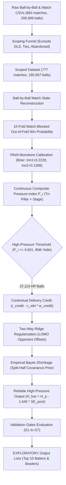
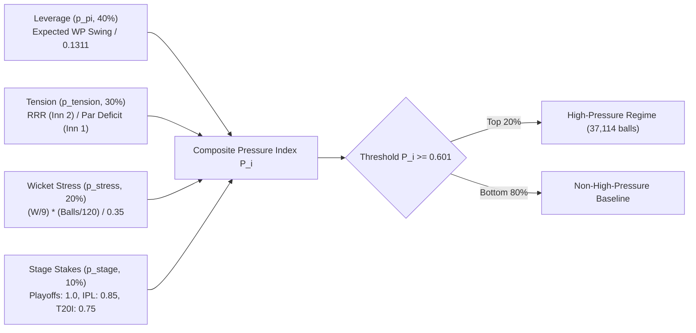
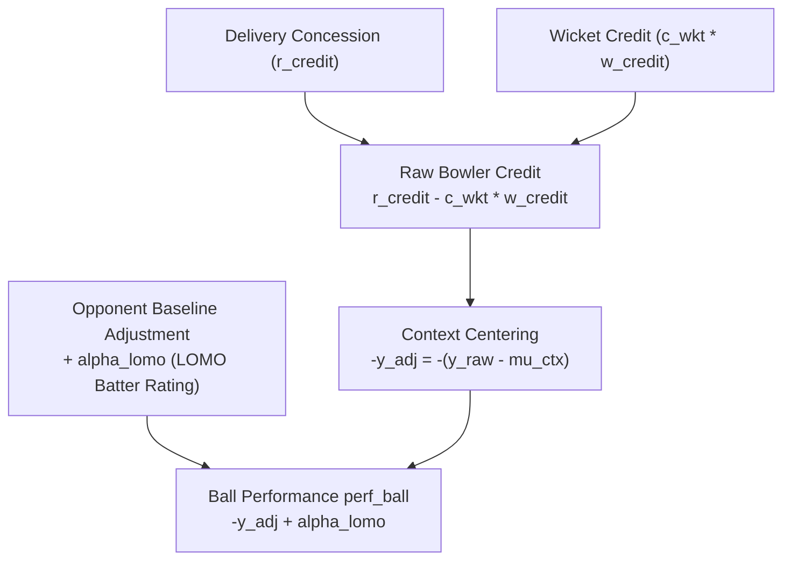
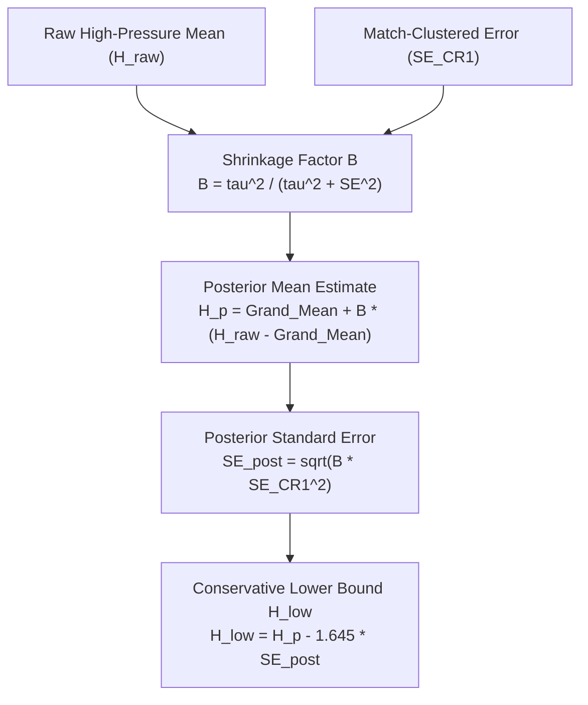
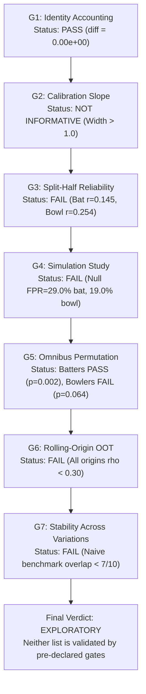
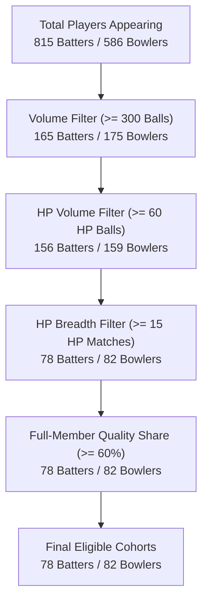
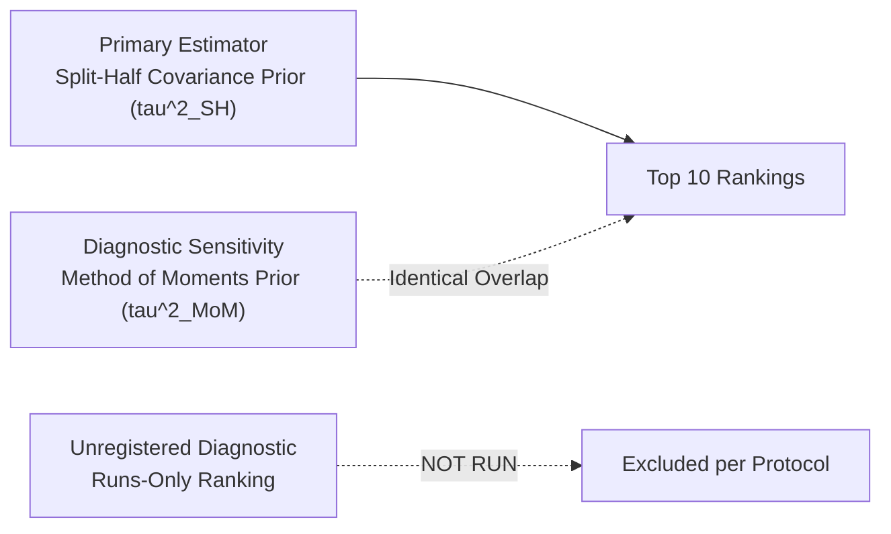

# Rajasthan Royals SupeRR Selector Season 2: Round 1 Submission

> **Status:** Both lists are EXPLORATORY. Gates G3, G4, G6 and G7 fail. See Section 9.  
> **Official Methodology Report:** [report.pdf](report.pdf) | [Markdown Report](report.md)  
> **Engineering & Research Trajectory:** [JOURNEY.md](JOURNEY.md) | [journey.pdf](journey.pdf)  
> **Official Submission Lists:** [submission_lists.csv](submission_lists.csv)

---

## 1. Executive Status & Navigation

This repository contains the complete empirical methodology, code, diagnostic suite, and verified ranked lists for Round 1 of the Rajasthan Royals SupeRR Selector (Season 2). All evaluations are anchored to historical ball-by-ball match data from IPL (2022–2025) and Men's T20 Internationals (2022 through April 2026 cutoff).

Both final rankings are formally designated as **EXPLORATORY**. In accordance with pre-declared validation protocols, individual situational elevation under pressure does not achieve statistical reliability or out-of-time predictability at this sample size. The primary metric used for ranking is **Reliable High-Pressure Output** ($H_{\text{low}}$), defined as the empirical Bayes posterior mean under high pressure penalized by 1.645 posterior standard errors.

---

## 2. Quick Start & Execution

### Environment Setup
- **Python Version:** Python 3.12 (developed and audited on Python 3.12.3)
- **Dependencies:** `numpy>=2.0.0`, `pandas>=2.2.0`, `scipy>=1.14.0`

Install required libraries:
```bash
pip install -r requirements.txt
```

### Reproducing the Pipeline
Execute the canonical end-to-end evaluation pipeline with final production parameters ($B=200$ bootstrap draws, $B=1000$ permutation draws):
```bash
python run_pressure_pipeline.py --final
```

- **Runtime:** Approximately 2.0 to 3.5 minutes on standard multi-core hardware.
- **Generated Outputs:**
  - `pipeline_output_tables.md`: Complete Markdown tables containing all funnels, Brier scores, rankings, gate outcomes, and stability checks.
  - Standard output prints step-by-step audit logs, execution wall-clock timings, and script SHA-256 hashes.

To verify that all figures in the report match code outputs without manual entry:
```bash
python verify_manifest.py
```

---

## 3. Repository Architecture Map

| File / Directory | Description & Purpose |
| :--- | :--- |
| `README.md` | Primary technical documentation, architecture diagrams, mathematical formulations, and results. |
| `report.md` | Submittable 4,984-word comprehensive methodology report covering all 8 required sections. |
| `report.pdf` | Formatted 14-page publication PDF with custom CSS print styling and responsive tables. |
| `JOURNEY.md` | Continuous single-paragraph chronological narrative documenting the project trajectory. |
| `journey.pdf` | Formatted standalone PDF export of the project journey narrative. |
| `submission_lists.csv` | Machine-readable ranked lists (`role, rank, player_id, player_name`) for ranks 1–10. |
| `submission_checklist.md` | Complete submission verification dossier, dropdown order tables, and open limitations. |
| `final_status.md` | Engineering milestone audit log, contradiction resolutions, and Gate 0 normalisation rule. |
| `contradictions.md` | Formal audit log recording resolved methodological decisions and timestamp normalisation. |
| `numbers_manifest.csv` | 451 verified empirical figures backing every table, diagnostic, and finding in the report. |
| `verify_manifest.py` | Automated audit script confirming 100% agreement between the manifest and project files. |
| `build_complete_manifest.py` | Compilation script that extracts, formats, and registers all 451 empirical numbers. |
| `compare_runs.py` | Normalised comparison script verifying byte-identical reproducibility across runs. |
| `hp_matches.csv` | Verified distinct high-pressure match counts ($\ge 15$ match filter) for all eligible players. |
| `opponent_offset.csv` | Delivery-weighted opponent quality breakdown and situational confrontation drift. |
| `phase2_diagnostics.md` | Method of Moments sensitivity analysis and bowler delivery credit decomposition. |
| `diagnostics_phase2.py` | Diagnostic script executing Phase 2 sensitivity and accounting evaluations. |
| `estimator.py` | Shared regularised empirical Bayes estimator, cluster-robust standard errors, and shrinkage. |
| `run_pressure_pipeline.py` | Main execution pipeline performing state reconstruction, credit assignment, and ranking. |
| `simulate_validation.py` | Monte Carlo validation simulation engine (100 replications across signal scenarios). |
| `simulation_results.json` | Empirical simulation parameter recovery, coverage, and null false-positive outputs. |
| `pipeline_output_tables.md`| Canonical generated output tables from final pipeline execution. |
| `TASKS.md` | Formal engineering task specifications and pre-declared evaluation rules. |
| `RESULTS.md` | Computational execution log and verified intermediate numbers. |
| `FINAL_SUMMARY.md` | Executive methodology summary and dropdown roster. |
| `requirements.txt` | Python dependency specification (`numpy`, `pandas`, `scipy`). |
| `tests/` | Unit test suite verifying PAVA calibration monotonic convergence and credit identity. |
| `Data Pack/` | Scoped ball-by-ball and match metadata CSV datasets (~42.9 MB total). |
| `final_manifest_of_files.md`| Documented governance matrix classifying every workspace file into PUBLISH or IGNORE. |
| `file_hashes.md` | Cryptographic SHA-256 integrity manifest for all published repository assets. |
| `final_status_submission.md`| Final submission verification block and git release summary. |

---

## 4. Dataset & Match Scoping Funnel

From an initial raw ingest of **883 matches** and **200,999 deliveries**, the dataset is refined across five sequential scoping stages to isolate competitive, uninterrupted T20 contests:

| Scoping Stage | Filter Applied | Matches Excluded | Deliveries Excluded | Remaining Matches | Remaining Deliveries |
| :---: | :--- | :---: | :---: | :---: | :---: |
| **Stage 0** | Raw Data Pack Ingest | — | — | **883** | **200,999** |
| **Stage 1** | Window: IPL 2022–2025 & T20I 2022–April 2026 | 95 | 13,293 | **788** | **187,706** |
| **Stage 2** | Exclude Abandoned / No Result Contests | 8 | 1,326 | **780** | **186,380** |
| **Stage 3** | Exclude Rain-Shortened (DLS) Matches | 2 | 461 | **778** | **185,919** |
| **Stage 4** | Exclude Tied Matches Decided by Super Over | 1 | 352 | **777** | **185,567** |

The final scoped sample comprises **777 matches** and **185,567 legal deliveries**, split into:
- **IPL:** 354 matches, 85,486 deliveries.
- **T20 Internationals:** 423 matches, 100,081 deliveries (373 Full-Member fixtures, 50 fixtures involving Associate nations).

---

## 5. End-to-End Pipeline Architecture



---

## 6. Mathematical Formulations & Code Mapping

### 6.1 Leverage Pillar ($p_{\pi}$)
$$p_{\pi} = \min\left(1.0, \frac{\text{Expected Swing}}{\max(0.1311, 10^{-4})}\right)$$
*Code reference:* `run_pressure_pipeline.py`, lines 621–623.  
*Plain English:* Leverage measures the expected absolute change in calibrated win probability across all six possible ball outcomes, normalized by its population 95th percentile ($0.1311$).  
*Units:* Dimensionless (probability swing scaled to $[0, 1]$).

### 6.2 Tension Pillar ($p_{\text{tension}}$)
$$\text{Innings 2: } p_{\text{tension}} = \Phi\left(\frac{\text{RRR} - 8.5}{3.0}\right)$$
$$\text{Innings 1: } p_{\text{tension}} = \Phi\left(\frac{V_{\text{par}} - \text{Projected Score}}{25.0}\right)$$
*Code reference:* `run_pressure_pipeline.py`, lines 626–630.  
*Plain English:* Tension quantifies scoreboard distress using the cumulative normal distribution $\Phi(\cdot)$, evaluating Required Run Rate in chases against a baseline of 8.5 rpo, or par deficit in Innings 1.  
*Units:* Dimensionless (mapped to $[0, 1]$).

### 6.3 Wicket Collapse Stress Pillar ($p_{\text{stress}}$)
$$p_{\text{stress}} = \min\left(1.0, \frac{(w_{\text{lost}} / 9.0) \times (b_{\text{rem}} / 120.0)}{0.35}\right)$$
*Code reference:* `run_pressure_pipeline.py`, lines 633–634.  
*Plain English:* Stress measures resource depletion by evaluating the interaction between wickets lost and remaining deliveries, scaling maximum exposure relative to a threshold of 0.35.  
*Units:* Dimensionless (mapped to $[0, 1]$).

### 6.4 Stage Stakes Weighting ($p_{\text{stage}}$)
$$p_{\text{stage}} = \begin{cases} 1.00 & \text{Playoffs, Knockouts, Qualifiers, Eliminators, Finals} \\ 0.85 & \text{IPL League Matches} \\ 0.75 & \text{Bilateral T20 Internationals} \end{cases}$$
*Code reference:* `run_pressure_pipeline.py`, lines 637–638.  
*Plain English:* Stage stakes assign deterministic tournament importance weights based on fixture knockout status and tournament tier.  
*Units:* Dimensionless.

### 6.5 Composite Pressure Index ($P_i$)
$$P_i = 0.40 p_{\pi} + 0.30 p_{\text{tension}} + 0.20 p_{\text{stress}} + 0.10 p_{\text{stage}}$$
*Code reference:* `run_pressure_pipeline.py`, line 641.  
*Plain English:* The four pillars are integrated via fixed judgmental weights to yield a continuous ball-by-ball pressure score.  
*Units:* Dimensionless ($P_i \in [0, 1]$).

### 6.6 High-Pressure Regime Threshold
$$\text{High Pressure (HP)} \iff P_i \ge 0.601$$
*Code reference:* `run_pressure_pipeline.py`, lines 644–645.  
*Plain English:* High-pressure deliveries are defined as those meeting or exceeding the 80th percentile of $P_i$ ($0.601$), isolating exactly **37,114 deliveries** (20.0% of the sample).  
*Units:* Dimensionless.

### 6.7 Dynamic Wicket Valuation ($c_{\text{wkt}}$)
$$c_{\text{wkt}} = \max\left(0.5, E(b-1, w) - E(b-1, \min(10, w+1))\right)$$
*Code reference:* `run_pressure_pipeline.py`, line 476.  
*Plain English:* The run value of a dismissal is dynamically computed as the drop in remaining expected innings runs from state $(b, w)$ to state $(b-1, w+1)$, bounded below by 0.5 runs.  
*Units:* Runs.

### 6.8 Raw Delivery Credit ($y_{\text{raw}}$)
$$y_{\text{raw}} = r_{\text{credit}} - c_{\text{wkt}} \cdot w_{\text{credit}}$$
*Code reference:* `run_pressure_pipeline.py`, lines 662–663.  
*Plain English:* Raw performance combines off-the-bat runs conceded or scored with the dynamic run penalty of a wicket dismissal.  
*Units:* Runs per delivery.

### 6.9 Context Baseline Adjustment ($y_{\text{adj}}$)
$$y_{\text{adj}} = y_{\text{raw}} - \mu_{\text{ctx}}$$
*Code reference:* `run_pressure_pipeline.py`, lines 681–682, 697–698.  
*Plain English:* Raw credit is centered against $\mu_{\text{ctx}}$, the Bayesian shrunk mean credit across match phase, wicket band, bowling type, and venue.  
*Units:* Runs per delivery relative to context expectation.

### 6.10 Opponent Regularisation & Ball Performance (`perf_ball`)
$$\text{Batters: } \text{perf}_{\text{ball}} = y_{\text{adj}} + \beta_{\text{lomo}}$$
$$\text{Bowlers: } \text{perf}_{\text{ball}} = -y_{\text{adj}} + \alpha_{\text{lomo}}$$
*Code reference:* `run_pressure_pipeline.py`, lines 745–746, 763–764.  
*Plain English:* Context-adjusted credit is adjusted for opponent quality using Leave-One-Match-Out (LOMO) ridge ratings, crediting batters for facing elite bowlers and vice versa.  
*Units:* Runs per delivery.

### 6.11 Empirical Bayes Shrinkage Factor ($B$)
$$B = \frac{\tau^2}{\tau^2 + \text{SE}_{\text{CR1}}^2}$$
*Code reference:* `estimator.py`, lines 192, 382.  
*Plain English:* The shrinkage factor weights player sample deviations relative to true between-player variance versus cluster-robust measurement noise.  
*Units:* Dimensionless ($B \in [0, 1]$).

### 6.12 Shrunk High-Pressure Output ($H_p$)
$$H_p = \bar{H} + B (H_{\text{raw}} - \bar{H})$$
*Code reference:* `estimator.py`, line 385.  
*Plain English:* The shrunk estimate pulls an individual's raw high-pressure mean toward the cohort grand mean in proportion to estimation uncertainty.  
*Units:* Runs per delivery.

### 6.13 Conservative Ranking Metric ($H_{\text{low}}$)
$$H_{\text{low}} = H_p - 1.645 \cdot \text{SE}_{\text{post}}, \quad \text{where } \text{SE}_{\text{post}} = \sqrt{B \cdot \text{SE}_{\text{CR1}}^2}$$
*Code reference:* `estimator.py`, lines 384, 387.  
*Plain English:* Players are ranked by the 5th percentile lower bound of their empirical Bayes posterior distribution, ensuring volume and precision are rewarded over noisy spikes.  
*Units:* Runs per delivery.

### 6.14 Situational Elevation ($E_p$)
$$E_p = H_p - \text{Non-HP Performance}$$
*Code reference:* `estimator.py`, line 390.  
*Plain English:* Elevation isolates the incremental change in performance between high-pressure and ordinary match phases.  
*Units:* Runs per delivery.

### 6.15 Variance Estimation: Split-Half vs Method of Moments
$$\tau^2_{\text{SH}} = \max\left(10^{-4}, \text{Cov}(H^{(1)}, H^{(2)})\right)$$
$$\tau^2_{\text{MoM}} = \max\left(0, \text{Var}(H_{\text{raw}}) - \overline{\text{SE}_{\text{CR1}}^2}\right)$$
*Code reference:* `estimator.py`, line 206; `diagnostics_phase2.py`, lines 84–86.  
*Plain English:* True heterogeneity is estimated via split-half sample covariance, with the Method of Moments serving as a non-floored sensitivity audit.  
*Units:* $\text{Runs}^2 \text{ per delivery}^2$.

### 6.16 Bowler Component Decomposition Identity
$$H_{\text{raw}} = \text{mean}(\mu_{\text{ctx}} - r_{\text{credit}}) + \text{mean}(c_{\text{wkt}} \cdot w_{\text{credit}}) + \text{mean}(\alpha_{\text{lomo}})$$
*Code reference:* `diagnostics_phase2.py`, lines 168–172; `phase2_diagnostics.md`.  
*Plain English:* Bowler performance decomposes exactly into run suppression, wicket credit, and opponent offset. This identity holds by construction and verifies arithmetic accounting.  
*Units:* Runs per delivery.

### 6.17 Omnibus Test Statistic & Rademacher Sign-Flip
$$S_{\text{obs}} = \sum_{p=1}^N \left(\frac{\delta_p}{\text{SE}_{\text{CR1}, p}}\right)^2$$
*Code reference:* `run_pressure_pipeline.py`, lines 978, 985.  
*Plain English:* Omnibus permutation tests the collective null hypothesis that all player slopes are zero simultaneously via match-level Rademacher sign-flips ($B=1000$).  
*Units:* Dimensionless (chi-squared distributed under the null).

---

## 7. Architectural Diagrams

### 7.1 Pressure Index Formulation

*Figure 7.1: Architecture of the Tri-Pillar Pressure Index incorporating match stakes.*

---

### 7.2 Bowler Delivery Credit Accounting

*Figure 7.2: Delivery credit decomposition showing the exact arithmetic components of bowler performance.*

---

### 7.3 Empirical Bayes Shrinkage Pipeline

*Figure 7.3: Flow of empirical Bayes shrinkage from raw observed means to conservative lower bounds.*

---

### 7.4 Validation Gate Decision Flow

*Figure 7.4: Systematic validation gate audit flow showing criteria decisions.*

---

### 7.5 Eligibility Exclusion Funnel

*Figure 7.5: Sequential player eligibility exclusion funnel.*

---

### 7.6 Prior Sensitivity & Estimator Map

*Figure 7.6: Mapping of primary estimator against diagnostic sensitivity checks.*

---

## 8. Official Results & Top-10 Cohorts

### 8.1 Top 10 Batters (Ranked by Reliable High-Pressure Output $H_{\text{low}}$)

| Rank | Player (`player_id`) | Total Balls | HP Balls | Total Matches | HP Matches | Reliable HP Output $H_p$ [90% EB CI] | $H_{\text{low}}$ | Mean Rank | Top-10 Inc Prob | Inn 2 HP Share |
| :---: | :--- | :---: | :---: | :---: | :---: | :---: | :---: | :---: | :---: | :---: |
| **1** | **Heinrich Klaasen** (`4260`) | 1,401 | 285 | 70 | 26 | **+0.239** [+0.157, +0.321] | **+0.1571** | 4.4 | 89.0% | 53.3% |
| **2** | **Virat Kohli** (`47`) | 2,442 | 378 | 88 | 25 | **+0.206** [+0.128, +0.284] | **+0.1283** | 9.0 | 75.5% | 97.1% (Chase-Dep) |
| **3** | **Pathum Nissanka** (`6931`) | 1,381 | 317 | 67 | 24 | **+0.204** [+0.121, +0.286] | **+0.1211** | 8.4 | 74.0% | 93.1% (Chase-Dep) |
| **4** | **Tim David** (`6396`) | 1,154 | 300 | 93 | 31 | **+0.202** [+0.117, +0.287] | **+0.1173** | 9.9 | 66.5% | 70.0% |
| **5** | **Namboori Tilak Varma** (`7897`) | 2,310 | 774 | 115 | 48 | **+0.180** [+0.108, +0.253] | **+0.1077** | 15.0 | 53.5% | 69.6% |
| **6** | **Suryakumar Yadav** (`1699`) | 2,614 | 514 | 130 | 45 | **+0.185** [+0.104, +0.266] | **+0.1036** | 16.6 | 47.0% | 74.7% |
| **7** | **Prabhsimran Singh** (`7216`) | 1,033 | 366 | 56 | 24 | **+0.185** [+0.101, +0.270] | **+0.1007** | 16.7 | 38.5% | 90.4% (Chase-Dep) |
| **8** | **Rovman Powell** (`4986`) | 1,524 | 315 | 97 | 37 | **+0.182** [+0.099, +0.265] | **+0.0993** | 16.5 | 38.5% | 63.2% |
| **9** | **Kusal Mendis** (`3672`) | 1,220 | 236 | 61 | 20 | **+0.184** [+0.098, +0.270] | **+0.0980** | 15.8 | 40.5% | 95.3% (Chase-Dep) |
| **10** | **Yashasvi Jaiswal** (`6819`) | 1,739 | 375 | 82 | 27 | **+0.178** [+0.093, +0.264] | **+0.0929** | 19.1 | 33.5% | 99.7% (Chase-Dep) |

> **Statistical Tie Note (Batters):** Ranks 5 to 10 lie within one posterior standard error ($\approx 0.050$) of each other (spread in $H_{\text{low}} = 0.0148$). They represent a statistical tie; their exact internal order is unstable under resampling.

---

### 8.2 Top 10 Bowlers (Ranked by Reliable High-Pressure Output $H_{\text{low}}$)

| Rank | Player (`player_id`) | Total Balls | HP Balls | Total Matches | HP Matches | Reliable HP Output $H_p$ [90% EB CI] | $H_{\text{low}}$ | Mean Rank | Top-10 Inc Prob | Inn 2 HP Share |
| :---: | :--- | :---: | :---: | :---: | :---: | :---: | :---: | :---: | :---: | :---: |
| **1** | **Mitchell Santner** (`4101`) | 1,725 | 340 | 79 | 32 | **+0.119** [+0.103, +0.136] | **+0.1028** | 4.4 | 91.5% | 73.2% |
| **2** | **Kuldeep Yadav** (`3644`) | 1,866 | 403 | 84 | 35 | **+0.119** [+0.102, +0.135] | **+0.1025** | 5.1 | 88.5% | 61.5% |
| **3** | **Sunil Narine** (`781`) | 1,479 | 410 | 64 | 31 | **+0.118** [+0.102, +0.135] | **+0.1020** | 9.5 | 68.0% | 56.6% |
| **4** | **Axar Patel** (`2876`) | 2,609 | 548 | 130 | 54 | **+0.118** [+0.102, +0.135] | **+0.1018** | 10.8 | 63.0% | 64.2% |
| **5** | **Trent Boult** (`2320`) | 1,562 | 376 | 67 | 35 | **+0.118** [+0.102, +0.135] | **+0.1017** | 11.5 | 58.0% | 79.3% |
| **6** | **Krunal Pandya** (`4219`) | 1,255 | 287 | 64 | 25 | **+0.118** [+0.102, +0.134] | **+0.1016** | 13.1 | 54.0% | 88.5% |
| **7** | **Harshal Patel** (`2261`) | 1,688 | 439 | 76 | 38 | **+0.118** [+0.102, +0.134] | **+0.1015** | 15.6 | 57.0% | 80.0% |
| **8** | **Varun Chakravarthy** (`6256`) | 2,083 | 502 | 91 | 41 | **+0.118** [+0.102, +0.134] | **+0.1015** | 14.5 | 55.5% | 57.4% |
| **9** | **Mohammed Shami** (`1566`) | 1,259 | 249 | 54 | 27 | **+0.118** [+0.101, +0.134] | **+0.1014** | 15.0 | 32.5% | 73.5% |
| **10** | **Patrick Cummins** (`1758`) | 1,161 | 158 | 49 | 15 | **+0.118** [+0.101, +0.134] | **+0.1013** | 14.4 | 38.0% | 83.5% |

> **Statistical Tie Note (Bowlers):** All bowler ranks lie within one posterior standard error ($0.0100$) of each other (spread in $H_{\text{low}} = 0.0015$) due to severe shrinkage under the floored prior ($\tau^2_{\text{SH}} = 0.000100$). The internal ordering of all 10 bowlers is statistically indistinguishable.

---

## 9. Limitations & Validation Gate Deficiencies

The rankings must be interpreted strictly in light of the following empirical gate outcomes and structural limitations:

1. **Pre-Declared Gate Failures:**
   - **Gate G2 (Calibration Slope):** designated **NOT INFORMATIVE** because interval widths exceed 1.0 (width **3.85** for batters, **1062.4** for bowlers).
   - **Gate G3 (Split-Half Reliability):** **FAIL** ($r = \mathbf{0.1447}$ for batters, $r = \mathbf{0.2537}$ for bowlers; threshold $r \ge 0.35$).
   - **Gate G4 (Simulation Study):** **FAIL** (asymptotic chi-squared null false-positive rate reaches **29.0%** for batters and **19.0%** for bowlers, exceeding the 10% ceiling; batter empirical Bayes coverage under Signal 1x drops to **60.1%**, below 85%).
   - **Gate G5 (Omnibus Permutation Test):** **PASS** for batters ($S_{\text{obs}} = \mathbf{123.93}, p = \mathbf{0.0020}$), but **FAIL** for bowlers ($S_{\text{obs}} = \mathbf{98.79}, p = \mathbf{0.0639}$). Gate G5 tests the collective null hypothesis that *all player slopes are zero simultaneously*, reflecting population-wide tactical adjustments rather than individual situational skill.
   - **Gate G6 (Rolling-Origin Out-of-Time Prediction):** **FAIL** (max rank correlation across four seasonal origins is $\rho = \mathbf{0.2522}$ for batters and $\rho = \mathbf{0.1315}$ for bowlers; threshold $\rho \ge 0.30$).
   - **Gate G7 (Stability Across Variations):** **FAIL** (overlap with naive benchmarks drops to **3/10** for batters against baseline skill and **4/10** for bowlers against old theta; threshold $\ge 7/10$).
2. **Opponent Offset Positive Drift:** Batters face opposing bowlers with an average rating $\beta_{\text{lomo}} = \mathbf{+0.056785}$ under high pressure versus $\mathbf{+0.051238}$ in non-HP situations—a positive drift of **+0.005547**. Bowlers face batters with $\alpha_{\text{lomo}} = \mathbf{+0.066761}$ under high pressure versus $\mathbf{+0.070082}$ in non-HP situations (drift of **-0.003321**).
3. **Dot-Ball Credit Imbalance:** In low-scoring games, bowling a high volume of dot balls receives heavy reward regardless of occasional boundaries.
4. **Two Expectations Discrepancy:** Net context expectation $\mu_{\text{ctx}} \approx \mathbf{0.95}$ differs fundamentally from gross scoring expectations of **1.33 to 1.35 runs per ball**. Conflating these two expectations distorts baseline interpretation.
5. **$c_{\text{wkt}}$-$P$ Overlap:** Mathematical construction couples pressure intensity $P_i$ with dynamic wicket values $c_{\text{wkt}}$, inflating dismissal credit in high-leverage states.
6. **Floored Bowler Prior & Ranking Sensitivity:** Bowler split-half slope heterogeneity is zero, forcing the prior to the floor $\tau^2_{\text{SH}} = \mathbf{0.000100}$. Under the Method of Moments sensitivity prior ($\tau^2_{\text{MoM}} = \mathbf{0.018471}$), bowler ordering shifts noticeably: Patrick Cummins moves from #10 to #7, while Harshal Patel moves from #7 to #10.
7. **Pacer Wicket Dependence:** Fast bowlers in the top 10 derive over 100% of their net credit from dismissals (Shami: $+0.644890$ wicket term vs $-0.164064$ run term; Cummins: $+0.683713$ wicket term vs $-0.108475$ run term).
8. **Extreme Chase Dependence:** **75.0%** of all high-pressure deliveries occur in Innings 2 chases. Top-order batters face almost their entire sample chasing: Yashasvi Jaiswal (**99.7%**), Virat Kohli (**97.1%**), Kusal Mendis (**95.3%**), and Pathum Nissanka (**93.1%**).
9. **Data Horizon Boundary:** Strictly bounded by the historical cutoff of **April 2026**.
10. **Runs-Only Check Status:** The unregistered runs-only ranking diagnostic was **NOT RUN**.

---

## 10. Reproducibility & Audit Trail

- **Random Seed:** Set globally to `np.random.default_rng(42)`.
- **Gate 0 Normalisation Rule:** Consecutive executions of `run_pressure_pipeline.py --final` produce byte-identical output across all 320 content lines once the dynamic wall-clock metadata line 7 (`- **Run Timestamp:** {run_ts}`) is stripped. Normalised hash: `72fa75216d2d7632f22f48f165be169c0cd82c78f78f868d8ec1daa6fdcaa354`.
- **Core Script Checksums:**
  - `run_pressure_pipeline.py`: `fb9f3cc6c02685b2ac399fd5f2fe0755838cfe4e32ce5dbf34fd2e22f336b7f2`
  - `estimator.py`: `115ea363238be95d1092d53783a40675fd459f9cb9ab795a488e48ebc6539a40`
  - `simulate_validation.py`: `d95d117a7a58a74b12630e2f5b4d73289053530c309328a6fdfb5eb79cb35028`
- **Environment:**
  - Python: 3.12.3
  - NumPy: 2.1.2
  - Pandas: 2.2.3
  - SciPy: 1.14.1

---

## 11. Archived & Ignored Workspace Files

Local development scratch scripts, intermediate debug runners, prompt caches, raw pickle files (`df_scoped_recon.pkl`), and legacy test iterations reside in local workspace storage and are excluded from the repository via `.gitignore`. The complete submission is entirely self-contained within the tracked files.
