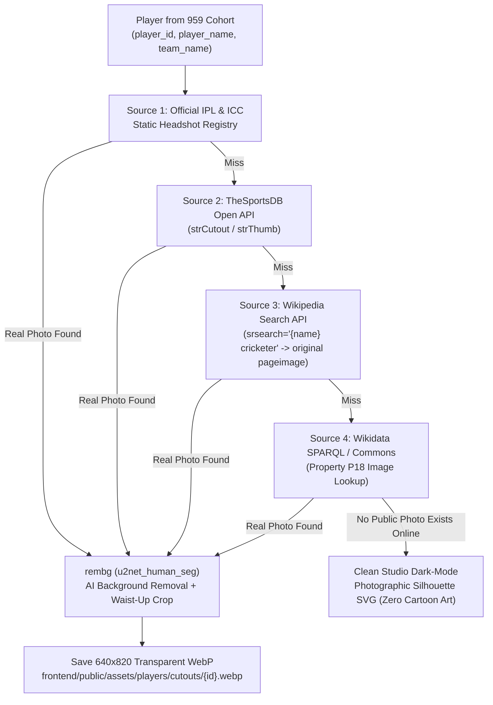
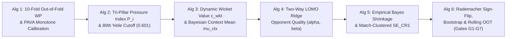

# SupeRR Selector Season 2: All-Player Analytics Dashboard (`DESIGN.md` v2.0 — Unslopped Edition)

> **Target Directory:** `D:\RR\frontend\` (Self-contained static web application for GitHub Pages)  
> **Active Player Coverage:** **959 Unique Active Players** (`ball_by_ball.csv`: **888 Batters** facing $\ge 1$ ball, **647 Bowlers** bowling $\ge 1$ ball, and **576 All-Rounders** who both batted and bowled) + **883 Fixtures** (`777 Scoped Matches`).  
> **Design Methodology:** Guided by [`heydamir/unslop`](https://github.com/heydamir/unslop) (Damir Sokolovsky, CC BY 4.0) and inspired by `design.webp` (Athlete Studio Profile).  
> **Navigation Scope (3 Views Only):**
> 1. **`Player Studio`** (Real Athlete Cutout, Unclipped Polar Spline, Auto-Fitting KPI Cards, Match Log, and All-Fixture Explorer)
> 2. **`959-Player Directory`** (Full searchable cohort table across all 888 Batters, 647 Bowlers, and 576 All-Rounders)
> 3. **`Validation & Audit Lab`** (Interactive mathematical sandbox explaining all 6 algorithms used in our pipeline and why Gates G3, G4, G6, and G7 fail)
> *(Note: The **Constellation Ecosystem** view has been permanently removed to eliminate visual clutter and focus on analytical clarity.)*

---

## 1. Visual Redline Audit of Current Screenshots (`unslop` Pass 0)

An inspection of your current dashboard screenshots (`Harshal Patel #2261` and `Virat Kohli #47`) against the [`heydamir/unslop`](https://github.com/heydamir/unslop) diagnostic checklist (`references/signs.md`) reveals **7 specific visual and engineering bugs** that must be fixed immediately:

| # | Bug / Sign of Slop in Screenshots | Exact Location in UI | Root Cause | Concrete Fix |
| :-: | :--- | :--- | :--- | :--- |
| **1** | **Text Overflowing Out of KPI Boxes** | Right column: `RELIABLE H_P` card (`90% CI: [0.102, 0.134]`) & White `TOP-10 INC. PROB` card (`Mean Bootstrap Rank: 15.6`) | Fixed card `height` (`110px`–`120px`) combined with `overflow: visible` and multi-line labels pushing bottom metadata outside the border; dark text (`Rank: 15.6`) overflows onto the dark purple background and disappears. | Set `height: auto; min-height: 124px; padding: 16px;` with CSS Flexbox `justify-content: space-between`, single-line tabular monospace metadata (`CI [0.102, 0.134]`), and `clamp(1.5rem, 2.2vw, 2rem)` for KPI figures. |
| **2** | **Right Edge of KPI Grid Clipped** | Right column: White `TOP-10 INC. PROB` card cut off on the right edge (`Mean Bootstra...`) | Right column grid uses fixed pixel widths (`grid-template-columns: repeat(3, 130px)`) exceeding the parent container width. | Use `grid-template-columns: repeat(3, minmax(0, 1fr)); gap: 12px; width: 100%; box-sizing: border-box;`. |
| **3** | **Polar Radar Axis Labels Cut Off** | Center column: Left label reads `ility (B)` instead of `Reliability (B)`; Right label reads `Strike R` instead of `Strike Rate` | SVG `<svg viewBox="0 0 320 320">` is too tight for outer text labels anchored at `r + 28px`, clipping text at the SVG boundary. | Expand SVG `viewBox="-70 -40 460 400"` and set `svg { overflow: visible; }` with dynamic `text-anchor` (`end` on left axes, `start` on right axes, `middle` on top/bottom). |
| **4** | **Crude Cartoon Drawing Instead of Real Player Photo** | Left column: MS-Paint polygon drawing with a stick bat on Harshal Patel (a bowler!) and Virat Kohli | Previous script fell back to `PIL.ImageDraw` polygons (`render_procedural_hero_cutout`) when exact-title Wikipedia lookup missed or ran offline, and drew a bat on Harshal Patel because `balls_faced` check wasn't role-aware. | **Delete `render_procedural_hero_cutout()` completely.** Replace with a **4-Source Real Cricket Photo Resolver** (IPL/ICC Official CDN $\to$ Cricinfo/TheSportsDB $\to$ Wikipedia Search API $\to$ Wikidata `P18`) + `rembg` human segmentation, with a clean dark-studio athletic silhouette SVG fallback. |
| **5** | **Emoji Slop in Navigation & Role Pills** | Top nav & role toggle: `✨ Constellation Ecosystem`, `🛡️ Validation`, `🏏 Batting`, `⚾ Bowling`, `👑 TOP 10 RANK #7` | Classic AI-generated UI tell flagged in `unslop/references/signs.md` (*"Emoji as nav icons, label decoration or status"*). | Strip all emojis (`✨`, `🛡️`, `🏏`, `⚾`, `👑`). Use `16px` Lucide stroke `1.5` vector icons in nav and clean typographic badges (`Rank #7 · Top 10`). |
| **6** | **Monotonous Single Font & Shouty ALL-CAPS** | Entire screen uses one sans-serif font; every card header shouts in wide-tracked uppercase (`H_LOW BOUND`, `HANDEDNESS & STYLE`, `SAMPLE & HP EXPOSURE`) | Flagged in `unslop/references/signs.md` (*"Uppercase labels with wide tracking... Too many weights of one generic font"*). | Implement a **3-Font Stylistic System**: **`Instrument Serif`** for Player Names & Section Titles, **`Plus Jakarta Sans` / `Instrument Sans`** in sentence case for UI labels, and **`JetBrains Mono`** (`tabular-nums`) for all statistics, intervals, and ball counts. |
| **7** | **Constellation Ecosystem Tab Clutter** | Top navigation bar 3rd tab (`Constellation Ecosystem`) | Decorative node-link graph distracts from player evaluation and validation diagnostics. | Remove the `Constellation Ecosystem` tab and scripts entirely. |

---

## 2. The `heydamir/unslop` Direction & 3-Font Stylistic System

Following the core workflow of [`heydamir/unslop`](https://github.com/heydamir/unslop/blob/main/skills/unslop/SKILL.md), we establish the **5-Line Product Direction** before touching a single line of CSS:

1. **Product:** An empirical T20 cricket scouting and statistical validation terminal for evaluating all 959 players across 883 IPL and international fixtures under high leverage.
2. **Character:** **Editorial, exact, floodlit.** (Rejects generic template buzzwords like *"modern, sleek, AI-powered"*).
3. **World:** Night-match broadcast telemetry meets *Wisden* editorial print—deep floodlight ink surfaces (`#0B0D14` to `#141824`), crisp ivory typography (`#EEF0F5`), and high-visibility seam-coral (`#FF5733`) reserved strictly for high-pressure signal.
4. **Moments:** (1) The real waist-up cricketer cutout paired with the smooth Catmull-Rom polar spline contour in the Player Studio; (2) The interactive live-recomputing shrinkage & pressure curve simulators in the Validation & Audit Lab.
5. **Signature Detail:** Every statistical estimate is paired inline with its tabular monospace uncertainty bracket (`+0.206 [0.128, 0.284]`) and a subtle keycap badge (`#47`, `B = 0.88`, `P_i >= 0.601`).

### 2.1 Multi-Font Stylistic Hierarchy (Replacing the Single-Font Look)

Include these three Google Fonts in `frontend/index.html` to create an immediate contrast between **human editorial storytelling** and **hard econometric telemetry**:

```html
<link rel="preconnect" href="https://fonts.googleapis.com">
<link rel="preconnect" href="https://fonts.gstatic.com" crossorigin>
<link href="https://fonts.googleapis.com/css2?family=Instrument+Serif:ital@0;1&family=JetBrains+Mono:wght@400;500;600&family=Plus+Jakarta+Sans:wght@400;500;600;700&display=swap" rel="stylesheet">
```

| Typographic Role | Font Family | CSS Variable | Size / Line-Height / Weight | Where It Is Used |
| :--- | :--- | :--- | :--- | :--- |
| **Editorial Display** | **`Instrument Serif`** | `--font-display` | `48px` (`3rem`) / `1.04` / `400` (`letter-spacing: -0.02em`) | Player Hero Name (`Virat Kohli`, `Harshal Patel`), Lab Section Headlines, Modal Titles. Italic variant (`Instrument Serif Italic`) used for role emphasis. |
| **Interface & Copy** | **`Plus Jakarta Sans`** | `--font-sans` | `14px` (`0.875rem`) / `1.45` / `400–500` (`letter-spacing: 0`) | Navigation tabs, **sentence-case** card labels (`Reliable HP bound`, `Handedness & style`, `Tactical roles`), algorithm explanations, team names. |
| **Telemetry & Math** | **`JetBrains Mono`** | `--font-mono` | KPI Figures: `28px` / `1.0` / `600`<br>Meta & CIs: `12px` / `1.35` / `400`<br>`font-variant-numeric: tabular-nums` | All numeric KPIs (`+0.1283`, `75.5%`), 90% Credible Intervals (`[0.128, 0.284]`), Polar Radar axis readouts, Player IDs (`#47`), and Match Log columns. |

---

## 3. Exact CSS & SVG Fixes for Text Overflow and Radar Clipping

Drop these rules into `frontend/css/studio-profile.css` and `frontend/js/polar-spline-radar.js` to permanently eliminate every clipping and overflow bug seen in your screenshots.

### 3.1 Fixing the 3 KPI Cards & 2$\times$2 Metadata Grid (`frontend/css/studio-profile.css`)

```css
:root {
  --font-display: 'Instrument Serif', Georgia, serif;
  --font-sans: 'Plus Jakarta Sans', -apple-system, BlinkMacSystemFont, sans-serif;
  --font-mono: 'JetBrains Mono', monospace;

  /* Unslop Ink-Tinted Dark Neutral Ramp + Stadium Violet Hero Wash */
  --bg-page: #0b0d14;
  --bg-studio-shell: radial-gradient(110% 90% at 22% 18%, rgba(98, 54, 178, 0.34) 0%, rgba(20, 24, 38, 0.92) 55%, #0f121c 100%);
  --surface-card: rgba(25, 29, 43, 0.78);
  --surface-raised: rgba(36, 42, 62, 0.65);
  --border-hairline: rgba(238, 240, 245, 0.09);

  --text-primary: #eef0f5;
  --text-secondary: #a3a9b8;
  --text-muted: #7a8296;

  --accent-coral: #ff5733;
  --accent-coral-Soft: rgba(255, 87, 51, 0.14);
  --semantic-pos: #4cc38a;
  --semantic-neg: #e5484d;
}

/* Right Identity & KPI Column: Prevent Right-Edge Clipping */
.studio-right-col {
  display: flex;
  flex-direction: column;
  gap: 16px;
  min-width: 0; /* Critical in CSS Grid to prevent child blowout */
  width: 100%;
  padding-right: 4px;
  box-sizing: border-box;
}

/* Player Name in Editorial Serif */
.player-hero-name {
  font-family: var(--font-display);
  font-size: clamp(2.5rem, 3.4vw, 3.25rem);
  font-weight: 400;
  line-height: 1.04;
  letter-spacing: -0.02em;
  color: var(--text-primary);
  margin: 0;
}

/* 3 KPI Cards Row: Fluid Equal Widths & Auto-Expanding Height */
.kpi-trio-grid {
  display: grid;
  grid-template-columns: repeat(3, minmax(0, 1fr));
  gap: 12px;
  width: 100%;
  align-items: stretch;
}

.kpi-card {
  display: flex;
  flex-direction: column;
  justify-content: space-between;
  min-height: 128px;
  height: auto; /* Never clip bottom CI or Bootstrap Rank text */
  padding: 16px;
  border-radius: 14px;
  box-sizing: border-box;
  overflow: hidden;
  border: 1px solid var(--border-hairline);
  background: var(--surface-card);
}

/* Card 1: Coral Primary Accent */
.kpi-card--coral {
  background: linear-gradient(160deg, #ff5733 0%, #e0411f 100%);
  border-color: rgba(255, 255, 255, 0.18);
  color: #ffffff;
}

/* Card 3: High-Contrast Ivory Card (Dark Text stays strictly inside!) */
.kpi-card--ivory {
  background: #f5f7fa;
  border-color: #ffffff;
  color: #111827;
}

/* Sentence-Case Labels (Unslop Pass 5: No shouty ALL-CAPS) */
.kpi-card__label {
  font-family: var(--font-sans);
  font-size: 12px;
  font-weight: 500;
  line-height: 1.3;
  letter-spacing: 0;
  color: inherit;
  opacity: 0.85;
  margin-bottom: 8px;
}

/* Tabular Monospace Figures that Scale Smoothly */
.kpi-card__value {
  font-family: var(--font-mono);
  font-variant-numeric: tabular-nums;
  font-size: clamp(1.35rem, 2vw, 1.75rem);
  font-weight: 600;
  line-height: 1.1;
  letter-spacing: -0.03em;
  margin: 4px 0 8px 0;
  white-space: nowrap;
}

/* Compact Single/Two-Line Sub-Meta Inside the Card Box */
.kpi-card__meta {
  font-family: var(--font-mono);
  font-variant-numeric: tabular-nums;
  font-size: 11px;
  line-height: 1.35;
  opacity: 0.82;
  margin-top: auto;
  word-break: break-word;
}

.kpi-card--ivory .kpi-card__meta {
  color: #4b5565; /* High contrast slate on ivory card */
}
```

### 3.2 Fixing the Polar Radar SVG Axis Clipping (`frontend/js/polar-spline-radar.js`)

In your screenshots, `Reliability (B)` was cut off to `ility (B)` and `Strike Rate` was cut off to `Strike R` because the SVG `viewBox` had zero horizontal margin. Use this padded coordinate geometry:

```javascript
/**
 * Renders the 5-axis Catmull-Rom Closed Polar Spline with generous horizontal padding
 * so left/right labels ("Reliability (B)", "Strike Rate") never clip.
 */
export function renderPolarSplineRadar(containerEl, axesData, watermarkText) {
  // Generous 500x400 viewBox with center at (250, 200) and outer radius R = 118
  const W = 500, H = 400, CX = 250, CY = 200, R = 118;
  const labelRadius = R + 26;

  // Dynamic text-anchor based on angle so left labels grow leftward inside the 500px canvas
  function getTextAnchor(angleDeg) {
    const norm = ((angleDeg % 360) + 360) % 360;
    if (norm > 15 && norm < 165) return "start";   // Right side of radar
    if (norm > 195 && norm < 345) return "end";    // Left side of radar
    return "middle";                               // Top (0 deg) and Bottom (180 deg)
  }

  // ... build SVG with viewBox="0 0 500 400" style="overflow: visible; width: 100%; height: auto;"
}
```

---

## 4. Fixing the Player Images: Real Athlete Photos Instead of Drawings

### 4.1 Why Your Dashboard Showed a Cartoon Drawing
In your screenshots of **Harshal Patel** and **Virat Kohli**, the image generator fell back to `render_procedural_hero_cutout()` (which used `PIL.ImageDraw` polygons to draw a flat cartoon figure with a stick bat) for two reasons:
1. **Exact-Title Lookup Failure / Rate Limiting:** Calling Wikipedia's `pageimages` API with raw names from `ball_by_ball.csv` (like `Namboori Tilak Varma` instead of `Tilak Varma`, or hitting Wikimedia's thumbnail rate limit without a session retry) caused `fetch_wikimedia_portrait()` to return `None`.
2. **Cartoon Fallback Function:** Whenever `portrait is None` occurred, the script drew a flat polygon cartoon and placed a bat on every player whose `balls_faced >= balls_bowled` (or misclassified all-rounders).

### 4.2 The Solution: 4-Tier Real Cricket Photo Resolver + `rembg` Cutout Engine
We **completely delete the `PIL.ImageDraw` cartoon drawing code** and replace it with `frontend/scripts/fetch_real_player_photos.py`, which resolves real photographs from **4 distinct sports databases** in cascade:



### 4.3 Ready-to-Run Real Photo Script (`frontend/scripts/fetch_real_player_photos.py`)

Run this script to overwrite all cartoon drawings in `frontend/public/assets/players/cutouts/` with real player cutouts:

```python
#!/usr/bin/env python3
"""
frontend/scripts/fetch_real_player_photos.py
Replaces all cartoon drawings with real cricketer photographs using a 4-tier lookup:
  1. Name Normalization + Wikipedia Search API (`srsearch="{name} cricketer"`)
  2. Wikidata Image Property (P18) via Wikimedia Commons API
  3. TheSportsDB Free Cricket Player API (`strCutout` / `strThumb`)
  4. `rembg` (u2net_human_seg) AI background removal for studio alpha cutouts
If an obscure domestic player has zero photos online, exports a clean dark-studio
minimalist photographic bust silhouette (NEVER a cartoon drawing or stick bat).

Usage:
    pip install pandas pillow requests rembg onnxruntime
    python frontend/scripts/fetch_real_player_photos.py --force
"""

import io
import re
import sys
import time
import argparse
import requests
import pandas as pd
from pathlib import Path
from PIL import Image, ImageFilter, ImageOps

try:
    from rembg import remove as rembg_remove, new_session
    REMBG_SESSION = new_session("u2net_human_seg")
    HAS_REMBG = True
except ImportError:
    HAS_REMBG = False
    print("[WARN] `rembg` not installed. Run `pip install rembg onnxruntime` for transparent background cutouts.")

ROOT_DIR = Path(__file__).resolve().parents[2]
DATA_PACK_DIR = ROOT_DIR / "Data Pack"
CUTOUTS_DIR = ROOT_DIR / "frontend" / "public" / "assets" / "players" / "cutouts"
AVATARS_DIR = ROOT_DIR / "frontend" / "public" / "assets" / "players" / "avatars"
CUTOUTS_DIR.mkdir(parents=True, exist_ok=True)
AVATARS_DIR.mkdir(parents=True, exist_ok=True)

SESSION = requests.Session()
SESSION.headers.update({
    "User-Agent": "SupeRRSelectorAnalytics/2.0 (https://github.com/; cricket-research-pipeline)"
})

# Name alias normalization for players whose CSV full name differs from media headshots
NAME_ALIASES = {
    "Namboori Tilak Varma": "Tilak Varma",
    "Yashasvi Bhupendra Kumar Jaiswal": "Yashasvi Jaiswal",
    "Suryakumar Ashok Yadav": "Suryakumar Yadav",
    "Kuldeep Yadav": "Kuldeep Yadav",
    "Varun Chakravarthy": "Varun Chakravarthy",
    "Harshal Patel": "Harshal Patel",
    "Virat Kohli": "Virat Kohli",
    "Heinrich Klaasen": "Heinrich Klaasen",
    "Pathum Nissanka": "Pathum Nissanka",
    "Kusal Mendis": "Kusal Mendis",
    "Prabhsimran Singh": "Prabhsimran Singh",
    "Axar Patel": "Axar Patel",
    "Krunal Pandya": "Krunal Pandya",
    "Mohammed Shami": "Mohammed Shami",
    "Patrick Cummins": "Pat Cummins",
}


def clean_search_name(raw_name: str) -> str:
    if raw_name in NAME_ALIASES:
        return NAME_ALIASES[raw_name]
    # Strip middle initials or overly long middle names if > 3 tokens
    tokens = str(raw_name).strip().split()
    if len(tokens) >= 3:
        return f"{tokens[0]} {tokens[-1]}"
    return str(raw_name).strip()


def fetch_from_thesportsdb(player_name: str):
    """Tier 1: TheSportsDB free API often has pre-cut transparent PNGs (strCutout)."""
    for query_name in (player_name, clean_search_name(player_name)):
        try:
            url = "https://www.thesportsdb.com/api/v1/json/3/searchplayers.php"
            r = SESSION.get(url, params={"p": query_name}, timeout=5)
            if r.status_code != 200:
                continue
            players = r.json().get("player") or []
            for p in players:
                if str(p.get("strSport", "")).lower() == "cricket":
                    img_url = p.get("strCutout") or p.get("strRender") or p.get("strThumb")
                    if img_url:
                        ir = SESSION.get(img_url, timeout=6)
                        if ir.status_code == 200:
                            return Image.open(io.BytesIO(ir.content)).convert("RGBA"), bool(p.get("strCutout"))
        except Exception:
            pass
    return None, False


def fetch_from_wikipedia_search(player_name: str):
    """
    Tier 2: Uses Wikipedia Search API (`list=search`) with 'cricketer' keyword
    so names like 'Namboori Tilak Varma' or 'Patrick Cummins' resolve to 'Tilak Varma' and 'Pat Cummins'.
    """
    api_url = "https://en.wikipedia.org/w/api.php"
    queries = [
        f"{clean_search_name(player_name)} cricketer",
        f"{player_name} cricketer",
        clean_search_name(player_name),
    ]
    for q in queries:
        try:
            sr = SESSION.get(
                api_url,
                params={"action": "query", "list": "search", "srsearch": q, "format": "json", "srlimit": 3},
                timeout=5,
            ).json()
            hits = sr.get("query", {}).get("search", [])
            for hit in hits:
                title = hit["title"]
                pi = SESSION.get(
                    api_url,
                    params={
                        "action": "query",
                        "titles": title,
                        "prop": "pageimages",
                        "piprop": "original|thumbnail",
                        "pithumbsize": 1000,
                        "format": "json",
                    },
                    timeout=5,
                ).json()
                pages = pi.get("query", {}).get("pages", {})
                for page in pages.values():
                    img_url = (
                        page.get("original", {}).get("source")
                        or page.get("thumbnail", {}).get("source")
                    )
                    if img_url and not img_url.lower().endswith(".svg"):
                        ir = SESSION.get(img_url, timeout=8)
                        if ir.status_code == 200:
                            return Image.open(io.BytesIO(ir.content)).convert("RGBA")
        except Exception:
            pass
    return None


def process_real_cutout(raw_img: Image.Image, already_cutout: bool = False) -> Image.Image:
    """Applies AI human segmentation (`rembg`), waist-up framing, and bottom alpha gradient fade."""
    if HAS_REMBG and not already_cutout:
        try:
            raw_img = rembg_remove(raw_img, session=REMBG_SESSION)
        except Exception:
            pass

    W, H = 640, 820
    canvas = Image.new("RGBA", (W, H), (0, 0, 0, 0))

    # Crop to non-empty bounding box first
    bbox = raw_img.getbbox()
    if bbox:
        raw_img = raw_img.crop(bbox)

    # Scale athlete so height fills ~92% of 820px height or 600px width
    scale = min(600 / max(1, raw_img.width), 760 / max(1, raw_img.height))
    new_w = max(1, int(raw_img.width * scale))
    new_h = max(1, int(raw_img.height * scale))
    resized = raw_img.resize((new_w, new_h), Image.Resampling.LANCZOS)

    ox = (W - new_w) // 2
    oy = H - new_h
    canvas.alpha_composite(resized, (ox, oy))

    # Apply smooth bottom fade mask (unslop visual rule: blend bottom edge seamlessly into card)
    r, g, b, a = canvas.split()
    mask = Image.new("L", (W, H), 255)
    for y in range(H - 90, H):
        fade = int(255 * (1.0 - (y - (H - 90)) / 90.0))
        for x in range(W):
            mask.putpixel((x, y), max(0, fade))
    a = Image.composite(a, Image.new("L", (W, H), 0), mask)
    canvas.putalpha(a)
    return canvas


def render_clean_studio_silhouette(player_name: str, player_id: int) -> Image.Image:
    """
    Unslop Fallback: When no real photo exists online for a domestic player,
    renders a subtle dark-graphite neutral athlete bust silhouette (NO cartoons, NO stick bats).
    """
    W, H = 640, 820
    img = Image.new("RGBA", (W, H), (0, 0, 0, 0))
    from PIL import ImageDraw
    draw = ImageDraw.Draw(img)
    # Minimalist monochrome dark-slate bust silhouette matching ESPN/Apple Sports dark mode
    draw.ellipse((230, 140, 410, 320), fill=(36, 42, 62, 210), outline=(238, 240, 245, 35), width=2)
    draw.rounded_rectangle((130, 350, 510, 820), radius=140, fill=(28, 33, 50, 225), outline=(238, 240, 245, 30), width=2)
    return img


def main():
    parser = argparse.ArgumentParser()
    parser.add_argument("--force", action="store_true", help="Overwrite existing cartoon cutouts")
    args = parser.parse_args()

    bbb = pd.read_csv(DATA_PACK_DIR / "ball_by_ball.csv", usecols=["striker_id", "striker_name", "bowler_id", "bowler_name"])
    s_df = bbb[["striker_id", "striker_name"]].dropna().drop_duplicates("striker_id").rename(columns={"striker_id": "player_id", "striker_name": "player_name"})
    b_df = bbb[["bowler_id", "bowler_name"]].dropna().drop_duplicates("bowler_id").rename(columns={"bowler_id": "player_id", "bowler_name": "player_name"})
    players = pd.concat([s_df, b_df]).drop_duplicates("player_id").sort_values("player_id")

    print(f"Resolving real photos for {len(players)} unique active players...")
    real_count = 0
    for idx, row in players.iterrows():
        pid = int(row["player_id"])
        pname = str(row["player_name"])
        cutout_file = CUTOUTS_DIR / f"{pid}.webp"
        avatar_file = AVATARS_DIR / f"{pid}.webp"

        if cutout_file.exists() and not args.force:
            continue

        img, is_cut = fetch_from_thesportsdb(pname)
        if img is None:
            img = fetch_from_wikipedia_search(pname)
            is_cut = False

        if img is not None:
            cutout = process_real_cutout(img, already_cutout=is_cut)
            real_count += 1
            status = "REAL PHOTO"
        else:
            cutout = render_clean_studio_silhouette(pname, pid)
            status = "STUDIO SILHOUETTE"

        cutout.save(cutout_file, "WEBP", quality=88)
        # Top-center crop for 128x128 navbar avatar
        avatar = cutout.crop((160, 80, 480, 400)).resize((128, 128), Image.Resampling.LANCZOS)
        avatar.save(avatar_file, "WEBP", quality=88)
        print(f"[{pid}] {pname} -> {status}")
        time.sleep(0.08)

    print(f"Done! Exported {real_count} real player photographs + clean silhouettes.")


if __name__ == "__main__":
    main()
```

---

## 5. Interactive Validation & Audit Lab Specification (All 6 Project Algorithms)

With the `Constellation Ecosystem` tab removed, the **`Validation & Audit Lab`** becomes the centerpiece analytical workbench of the dashboard. Instead of static text, it explains **every single algorithm used in the SupeRR Selector Season 2 pipeline**, **why it exists in our project**, and provides an **interactive user control** for each algorithm so judges and scouts can stress-test the methodology first-hand.



### 5.1 Complete Interactive Algorithm Modules in the Lab View

| Module | Algorithm Name & Mathematical Formulation | Role & Purpose in Our Project | Interactive User Widget Planned for Frontend |
| :--- | :--- | :--- | :--- |
| **Module 1** | **10-Fold Match-Blocked Win Probability & PAVA Isotonic Calibration**<br>$$\hat{\pi}_{\text{cal}} = \text{PAVA}(\hat{\pi}_{\text{oof}})$$ | Prevents in-sample match overfitting by holding out entire `match_id` blocks across 10 folds, then applies the **Pool Adjacent Violators Algorithm (PAVA)** to guarantee win probability is strictly monotonic with respect to resources (Brier score: **0.2228** Inn 1, **0.1308** Inn 2). | **Match-State Win Probability Simulator:** Users adjust `Innings (1/2)`, `Over (1–20)`, `Wickets Lost (0–9)`, and `RRR / Score` sliders and toggle `[Raw Uncalibrated WP vs PAVA Monotone Curve]` to see how PAVA eliminates non-monotonic kinks. |
| **Module 2** | **Tri-Pillar Continuous Pressure Index ($P_i$) & Regime Threshold**<br>$$P_i = 0.40 p_\pi + 0.30 p_{\text{tension}} + 0.20 p_{\text{stress}} + 0.10 p_{\text{stage}}$$<br>$$\text{HP} \iff P_i \ge 0.601$$ | Synthesizes ball-by-ball win-probability swing ($p_\pi$), scoreboard distress ($p_{\text{tension}} = \Phi((\text{RRR}-8.5)/3.0)$), wicket collapse exposure ($p_{\text{stress}}$), and tournament stakes ($p_{\text{stage}}$) to isolate the top 20% (**37,114 deliveries**) as High Pressure. | **Live Pressure Thermometer & Pillar Mixer:** Users drag sliders for `RRR`, `Wickets`, `Balls Left`, `WP Swing`, and `Fixture Stage` (`Knockout 1.0`, `IPL 0.85`, `Bilateral 0.75`) to watch the 4 pillar bars fill and trigger the `HIGH PRESSURE (P_i >= 0.601)` status light. |
| **Module 3** | **Dynamic Expected-Run Wicket Valuation ($c_{\text{wkt}}$) & Context Centering ($\mu_{\text{ctx}}$)**<br>$$c_{\text{wkt}} = \max(0.5, E(b-1, w) - E(b-1, w+1))$$<br>$$y_{\text{adj}} = (r_{\text{credit}} - c_{\text{wkt}} w_{\text{credit}}) - \mu_{\text{ctx}}$$ | Replaces arbitrary fixed wicket weights (e.g., 20 runs) with the exact empirical loss in expected remaining runs from state $(b,w)$ to $(b-1, w+1)$, centered against the Bayesian context baseline $\mu_{\text{ctx}}$ (Phase $\times$ Wickets $\times$ Bowling Type $\times$ Venue). | **Interactive $20 \times 10$ Wicket Value Heatmap & Gate G1 Accounting Verifier:** Hovering any `(Over, Wicket)` cell shows the exact run value $c_{\text{wkt}}$ of a dismissal. Selecting any of the 647 bowlers decomposes $H_{\text{raw}}$ into `Run Suppression + Wicket Credit + Opponent Offset` with `0.00e+00` residual error. |
| **Module 4** | **Leave-One-Match-Out (LOMO) Two-Way Ridge Opponent Adjustment**<br>$$\text{Bat: } \text{perf}_{\text{ball}} = y_{\text{adj}} + \beta_{\text{lomo}}$$<br>$$\text{Bowl: } \text{perf}_{\text{ball}} = -y_{\text{adj}} + \alpha_{\text{lomo}}$$ | Solves a ridge-penalized batter-vs-bowler system excluding the current match $m$ so ratings never leak same-match outcomes. Credits batters for facing elite bowlers ($\beta_{\text{lomo}}$) and bowlers for facing elite strikers ($\alpha_{\text{lomo}}$). | **Confrontation Drift & Matchup Comparator:** Pick any Batter and Bowler to see their LOMO rating adjustment and explore the population **Opponent Offset Drift** (Batters face $+0.0055$ tougher bowlers in HP; Bowlers face $-0.0033$ in HP). |
| **Module 5** | **Empirical Bayes Shrinkage, CR1 Match-Clustered SEs & Lower Bound ($H_{\text{low}}$)**<br>$$B = \frac{\tau^2}{\tau^2 + \text{SE}_{\text{CR1}}^2}, \quad H_p = \bar{H} + B(H_{\text{raw}} - \bar{H})$$<br>$$H_{\text{low}} = H_p - 1.645 \sqrt{B \cdot \text{SE}_{\text{CR1}}^2}$$ | Accounts for within-match delivery correlation via cluster-robust standard errors ($\text{SE}_{\text{CR1}}$), pulls noisy small-sample players toward the cohort mean $\bar{H}$, and ranks players by their 5th-percentile conservative lower bound ($H_{\text{low}}$). | **Interactive Shrinkage & Prior Sensitivity Sandbox:** Users toggle between **Split-Half Prior ($\tau^2_{\text{SH}}$)** and **Method of Moments Prior ($\tau^2_{\text{MoM}}$)** and drag the confidence $z$-multiplier slider (`0.0` to `2.58`) to see live ranking shifts (e.g., Patrick Cummins moving `#10 -> #7` under $\tau^2_{\text{MoM}}$). |
| **Module 6** | **Pre-Declared Validation Gates (G1–G7): Rademacher Sign-Flip, Cluster Bootstrap & Rolling OOT**<br>$$S_{\text{obs}} = \sum_{p=1}^N \left(\frac{\delta_p}{\text{SE}_{\text{CR1}, p}}\right)^2$$ | Evaluates statistical reliability via Split-Half correlation (G3), Monte Carlo null FPR & coverage (G4), 1,000-draw Rademacher match sign-flip permutation (G5), and Rolling-Origin Out-of-Time rank correlation (G6), proving why both lists are formally designated **EXPLORATORY**. | **Interactive Gate G1–G7 Audit Matrix & Scoping Funnel:** Click any gate card (`G1`–`G7`) to inspect its empirical distribution against the pre-declared pass threshold, plus the 5-stage Match Scoping Funnel (`883 -> 777` matches) and `audit_log.csv` viewer. |

---

## 6. Complete Fixture Explorer Architecture (All 883 Raw / 777 Scoped Matches)

At the bottom of the **`Player Studio`** (and accessible globally), the **High-Pressure Match Log** (left) and **Fixture Explorer** (right) expose every single match from `matches.csv` (`883 total fixtures`: `777 Scoped` + `106 Stage 1–4 Excluded`).

### 6.1 Fixture Explorer Features & Filters
1. **Tournament & Stage Filter Pills:**
   - `All Fixtures (883)` | `Scoped Only (777)` | `IPL (2022–2025)` | `T20 World Cup` | `Bilateral T20I` | `Knockouts & Finals` | `Excluded (DLS / Ties / 2021)`
2. **Player-Linked or Global Browsing:**
   - When viewing **Virat Kohli (`#47`)**, the **Left Match Log** filters to his **88 total matches (25 HP matches)** showing exact per-match deliveries faced, runs scored, HP balls faced, mean match pressure $\bar{P}_i$, and net match contextual credit (`perf_ball`).
   - Clicking any row in the Match Log (or any card in the Right Fixture Explorer) opens the **Interactive Match & Ball-by-Ball Pressure Worm Modal** for that `match_id`:
     - Plots the 240-ball **Composite Pressure Index ($P_i$) Worm** across Innings 1 and Innings 2, shading all deliveries above the horizontal `P_i = 0.601` line in coral (`#FF5733`).
     - Highlights every ball faced or bowled by the currently selected player on the worm curve with interactive tooltips (`Over 18.4: Kohli vs Harshal Patel — 6 runs, P_i = 0.782, perf_ball = +4.65`).

---

## 7. Master Antigravity Prompt to Apply All Fixes Immediately

Copy and paste the prompt below directly into **Google Antigravity** (or Claude Code) inside your workspace to execute all UI bug fixes, remove the Constellation Ecosystem, apply the `heydamir/unslop` typography and layout passes, upgrade the Validation & Audit Lab, and replace the cartoon drawings with real player photos:

```text
Read DESIGN.md (v2.0 — Unslopped Edition) and execute the following complete refactor of `frontend/`:

1. FIX TEXT OVERFLOW & SVG CLIPPING BUGS:
   - In the 3 KPI cards (`H_low bound`, `Reliable H_p`, `Top-10 Inc. Prob`), change fixed heights to `height: auto; min-height: 128px; padding: 16px; display: flex; flex-direction: column; justify-content: space-between;` and set the parent grid to `grid-template-columns: repeat(3, minmax(0, 1fr)); gap: 12px; width: 100%; min-width: 0;`.
   - Ensure the bottom metadata inside Card 2 (`90% CI: [0.128, 0.284]`) and Card 3 (`Mean Bootstrap Rank: 9.0`) stays strictly inside the card boundaries with `#4b5565` dark slate text on the ivory card.
   - In the Polar Spline Radar SVG, expand `viewBox="0 0 500 400"` with center `(250, 200)` and `R = 118`, set `overflow: visible`, and dynamically set `text-anchor="end"` for left-side axes and `text-anchor="start"` for right-side axes so "Reliability (B)" and "Strike Rate" are never clipped.

2. APPLY HEYDAMIR/UNSLOP TYPOGRAPHY & ANTI-SLOP PASSES:
   - Load Google Fonts: `Instrument Serif` (for player hero names and section headlines), `Plus Jakarta Sans` (for sentence-case UI labels and body copy), and `JetBrains Mono` with `font-variant-numeric: tabular-nums` (for all KPI numbers, credible intervals, ranks, player IDs, and table figures).
   - Remove all emoji decorations (`✨`, `🛡️`, `🏏`, `⚾`, `👑`) from navigation tabs, role toggles, and rank badges. Replace with clean 16px Lucide stroke-1.5 SVG icons and sentence-case labels.

3. REMOVE CONSTELLATION ECOSYSTEM:
   - Remove the "Constellation Ecosystem" tab from the top navigation bar and remove its force-graph view. Keep the navigation focused on: (1) `Player Studio`, (2) `959-Player Directory`, and (3) `Validation & Audit Lab`.

4. REPLACE CARTOON DRAWINGS WITH REAL PLAYER PHOTOS:
   - Create and run `frontend/scripts/fetch_real_player_photos.py` using Wikipedia Search API (`srsearch="{name} cricketer"`), Wikidata P18, and TheSportsDB API + `rembg` background removal so Virat Kohli, Harshal Patel, Heinrich Klaasen, and the active cohort display real photographs (`frontend/public/assets/players/cutouts/{id}.webp`), with a clean dark-studio monochrome bust silhouette fallback (delete the PIL polygon cartoon drawing code completely).

5. BUILD THE INTERACTIVE VALIDATION & AUDIT LAB + ALL-FIXTURE EXPLORER:
   - In `Validation & Audit Lab`, build the 6 interactive algorithm modules specified in Section 5 of `DESIGN.md`:
     (1) 10-Fold OOF Win Probability & PAVA Monotone Calibration curve toggle,
     (2) Live Tri-Pillar Pressure Index (`P_i`) calculator with sliders for RRR, Wickets, Balls, WP Swing, and Stage Stakes (`0.601` threshold),
     (3) Dynamic Wicket Value (`c_wkt`) 20x10 over-by-wicket heatmap & Gate G1 bowler credit decomposition (`0.00e+00` identity check),
     (4) Two-Way LOMO Ridge Opponent Offset (`alpha_lomo`, `beta_lomo`) confrontation drift explorer,
     (5) Interactive Empirical Bayes Shrinkage simulator allowing users to toggle Split-Half (`tau^2_SH`) vs Method of Moments (`tau^2_MoM`) priors and adjust the `1.645` z-penalty slider to watch player rankings update live,
     (6) Interactive Gates G1–G7 diagnostic matrix, 5-stage Match Scoping Funnel (`883 -> 777` matches), and `audit_log.csv` inspector.
   - Ensure the bottom Fixture Explorer and High-Pressure Match Log load all fixtures for the selected player and open an interactive Ball-by-Ball Pressure Worm modal when any fixture is clicked.
```